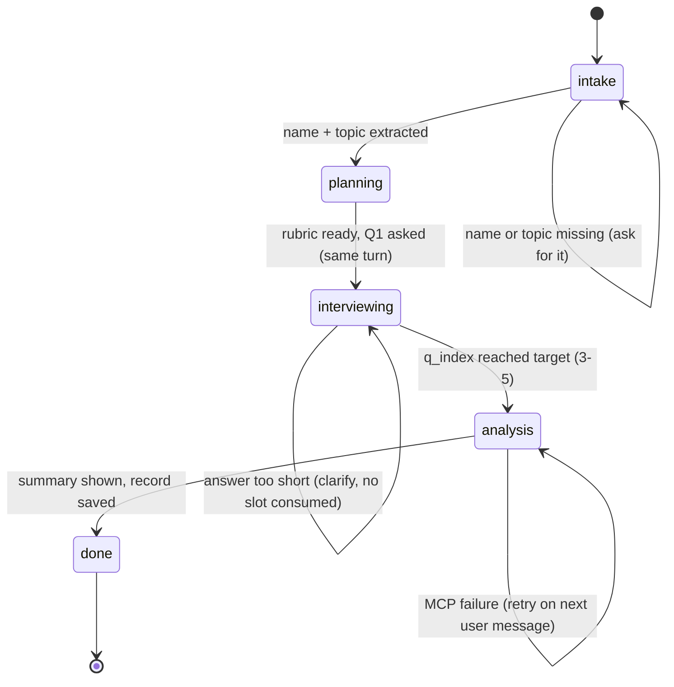

# AGENT_SERVICE.md — Google ADK Harness

The `agent` service hosts the conversational harness built with **Google ADK**. It is served by `adk web` (UI + REST/SSE API) on port `8000`.

---

## 1. Responsibilities

- Run the interview conversation across multiple user turns.
- Drive phase transitions deterministically (state machine).
- Call the LLM for judgment tasks only: intake extraction, rubric planning, question generation, summary.
- Call the `mcp` service for NLP enrichment and persistence.
- Render clean, human-readable messages to the user.

**Must not:** import `torch`/`transformers`/`neo4j`, write interview files, or let an LLM decide phase transitions or question count.

---

## 2. Agent Tree

```text
root_agent = InterviewOrchestrator (custom BaseAgent)      # state machine, the only agent the Runner sees
├── IntakeAgent        (LlmAgent, output_schema=IntakeResult)
├── PlannerAgent       (LlmAgent, output_schema=Rubric)
├── InterviewerAgent   (LlmAgent, output_schema=InterviewerTurn)
└── AnalysisPipeline   (SequentialAgent)
    ├── EnrichmentStep (custom BaseAgent → MCP analyze_answers)
    ├── SummarizerAgent(LlmAgent, output_schema=InterviewSummary)
    └── PersistStep    (custom BaseAgent → MCP save_interview)
```

All sub-agents are registered in `sub_agents=[...]` of the orchestrator (so ADK tracks the hierarchy), but they are **invoked explicitly** from `_run_async_impl`; no `transfer_to_agent`.

---

## 3. State Machine



### Turn algorithm (per incoming user message)

| `phase` | Steps executed in this single turn |
|---|---|
| `intake` | Run `IntakeAgent` on the message. If `user_name` or `topic` missing → ask only for the missing field, stay. Else → set `user_id` (slug of name), `interview_id` (uuid4), then **fall through** to `planning`. |
| `planning` | Run `PlannerAgent` → `rubric`. Compute `target_questions = clamp(len(rubric.areas), 3, 5)`. Emit rubric + privacy notice. Run `InterviewerAgent` → emit Q1, set `pending_question`. Set `phase = interviewing`. |
| `interviewing` | Validate the answer (see §6). Append `TranscriptTurn` to `transcript`, `q_index += 1`. If `q_index >= target_questions` (or `q_index >= 3` and the interviewer flagged `coverage_complete`) → `phase = analysis` and **fall through**. Else run `InterviewerAgent` → emit next question. |
| `analysis` | Run `AnalysisPipeline`. On success → emit final report, `phase = done`. On MCP failure → emit error message, stay in `analysis`. |
| `done` | Reply that the interview is finished and suggest starting a new session. |

"Fall through" = continue to the next phase inside the same invocation, so the user never has to send a filler message.

---

## 4. Session State

Session-scoped keys (no prefix). Only the orchestrator and steps write them.

| Key | Type | Written by | Notes |
|---|---|---|---|
| `phase` | `"intake" \| "planning" \| "interviewing" \| "analysis" \| "done"` | orchestrator | initialized to `intake` |
| `user_name`, `user_id`, `topic` | `str` | orchestrator (from `IntakeResult`) | |
| `interview_id` | `str` (uuid4) | orchestrator | idempotency key for persistence |
| `rubric` | `Rubric` (dict) | PlannerAgent via `output_key` | |
| `target_questions` | `int` 3–5 | orchestrator | |
| `q_index` | `int` | orchestrator | number of answered questions |
| `pending_question` | `InterviewerTurn` (dict) | orchestrator | question awaiting an answer |
| `clarification_used` | `bool` | orchestrator | reset after each accepted answer |
| `transcript` | `list[TranscriptTurn]` | orchestrator | |
| `nlp_results` | `AnalyzeAnswersResult` | EnrichmentStep | |
| `summary` | `InterviewSummary` | SummarizerAgent via `output_key` | |
| `persist_result` | `SaveInterviewResult` | PersistStep | |

Schemas: [`DATA_MODEL.md`](DATA_MODEL.md).

### State-update rules (ADK gotchas)
- Persist state changes **through events** (`EventActions(state_delta=...)`) or through `output_key`; changes are committed by the Runner only when the event is yielded.
- If a sub-agent's raw JSON event is not forwarded to the user (to keep the UI clean), the orchestrator must re-emit the parsed value in its own event's `state_delta`; otherwise the state is lost.
- Store plain JSON-serializable dicts in state (`model.model_dump()`), not Pydantic objects.

---

## 5. Sub-Agent Specifications

| Agent | Model | `include_contents` | `output_schema` | `output_key` | Reads from state |
|---|---|---|---|---|---|
| IntakeAgent | fast model | `default` (needs the user message) | `IntakeResult` | `intake` | — |
| PlannerAgent | fast model | `none` | `Rubric` | `rubric` | `{topic}` |
| InterviewerAgent | fast model | `none` | `InterviewerTurn` | `pending_question` | `{topic}`, `{rubric}`, `{transcript}`, `{q_index}`, `{target_questions}` |
| SummarizerAgent | fast or stronger model | `none` | `InterviewSummary` | `summary` | `{topic}`, `{rubric}`, `{transcript}`, `{nlp_results}` |

`include_contents="none"` + `{state}` templating means each call receives exactly the context it needs — deterministic, compact, and friendly to small local models.

> `output_schema` agents must not rely on tools. Tool usage happens only in the custom steps.

### Prompt guidelines (`prompts.py`)
- **Planner:** produce 3–5 distinct, non-overlapping thematic areas for the topic, each with a one-line description and 1–2 example angles. Neutral framing; no leading assumptions.
- **Interviewer:**
  - Exactly **one** open-ended question per turn; no multi-part questions; no yes/no.
  - Neutral, curious, non-leading; never evaluate or judge the answer.
  - Prefer an **uncovered** area; a follow-up on the same area is allowed if the last answer opened a rich thread (`is_follow_up = true`, must reference something specific the user said).
  - `area` must be one of `rubric.areas[].name` (validated in code; fallback = first uncovered area).
  - Set `coverage_complete = true` only when all areas are covered and `q_index >= 3`.
  - Never ask for personal identifiers.
- **Summarizer:** themes grounded in the transcript; sentiment description must be consistent with `nlp_results.session_sentiment`; quotes must be verbatim substrings of answers (validated in code, drop non-matching quotes).

---

## 6. Answer Validation (deterministic)

| Condition | Action |
|---|---|
| Empty or < 3 words, and `clarification_used = false` | Ask a gentle clarification of the same question, set `clarification_used = true`, no slot consumed |
| Still short after clarification | Accept as-is |
| User types `skip` | Record answer as `"[skipped]"`, excluded from NLP |
| User types `stop` / `end interview` | Jump to `analysis` if `q_index >= 1`, else to `done` without saving |

---

## 7. Analysis Pipeline

1. **EnrichmentStep** — builds `[{answer_id, text}]` from `transcript` (skips `[skipped]`), calls MCP `analyze_answers`, writes `nlp_results`.
2. **SummarizerAgent** — LLM summary using rubric + transcript + NLP results.
3. **PersistStep** — assembles `InterviewRecord` (see [`DATA_MODEL.md`](DATA_MODEL.md)), calls MCP `save_interview`, writes `persist_result`.
4. Orchestrator renders the final report.

### Final report layout
1. Headline: topic, number of questions, overall sentiment (label + score).
2. Key themes (bullets), key points (bullets), 1–3 quotes.
3. Per-answer table: area · sentiment · top keywords.
4. Persistence status: JSON path, Neo4j status (warning line if `skipped`/`error`).
5. Cypher query for Neo4j Browser (from `persist_result.cypher_query`).

---

## 8. MCP Integration

- **Transport:** Streamable HTTP, URL from `MCP_SERVER_URL` (default `http://mcp:8001/mcp`), optional `Authorization: Bearer ${MCP_AUTH_TOKEN}` header.
- **Deterministic steps** (`EnrichmentStep`, `PersistStep`) use a thin wrapper in `mcp_client.py` built on the official `mcp` client SDK (`ClientSession.call_tool`). It handles: connection, timeout, one retry, parsing `structuredContent` into Pydantic models.
- **`McpToolset`** (ADK) is reserved for any future `LlmAgent` that should choose tools itself; if used, always set `tool_filter` to the minimal tool list.
- The agent never caches MCP results across sessions.

---

## 9. Model Configuration

| Env var | Example | Meaning |
|---|---|---|
| `LLM_MODEL` | `gemini-2.5-flash` | Model for Intake/Planner/Interviewer |
| `LLM_MODEL_SUMMARY` | `gemini-2.5-flash` | Model for Summarizer (defaults to `LLM_MODEL`) |
| `GOOGLE_API_KEY` | — | Required for Gemini models |
| `OLLAMA_API_BASE` | `http://ollama:11434` or `http://host.docker.internal:11434` | Required for `ollama_chat/...` models |

Rule in `config.py`: names starting with `gemini` are passed as plain strings; anything else is wrapped in `LiteLlm(model=...)`.

> Small local models (e.g., `qwen3:1.7b`) are unreliable with structured output. Use at least a ~7–8B model locally (e.g., `ollama_chat/qwen3:8b`) or Gemini Flash. For Qwen3, disable "thinking" output so it does not pollute JSON.

---

## 10. Runtime

- Command: `adk web --host 0.0.0.0 --port 8000 --session_service_uri sqlite:////app/sessions/sessions.db /app/agents`
- `/app/agents/interviewer_app` is the agent package; `root_agent` is exported from `agent.py`.
- Healthcheck: `GET /list-apps` returns `["interviewer_app"]`.

---

## 11. Testing

| Level | What | How |
|---|---|---|
| Unit | Orchestrator transitions, answer validation, clamp logic, quote validation | Fake LLM agents returning canned structured outputs; fake MCP client |
| Contract | Agent `schemas.py` ≡ MCP `schemas.py` | Compare JSON Schemas generated from both |
| Eval | Conversation quality | `adk eval` with 2–3 scripted evalsets (question count 3–5, valid areas, one question per turn) |
| E2E | Full stack | `docker compose` + scripted client against `adk web` API, Neo4j stopped variant included |
