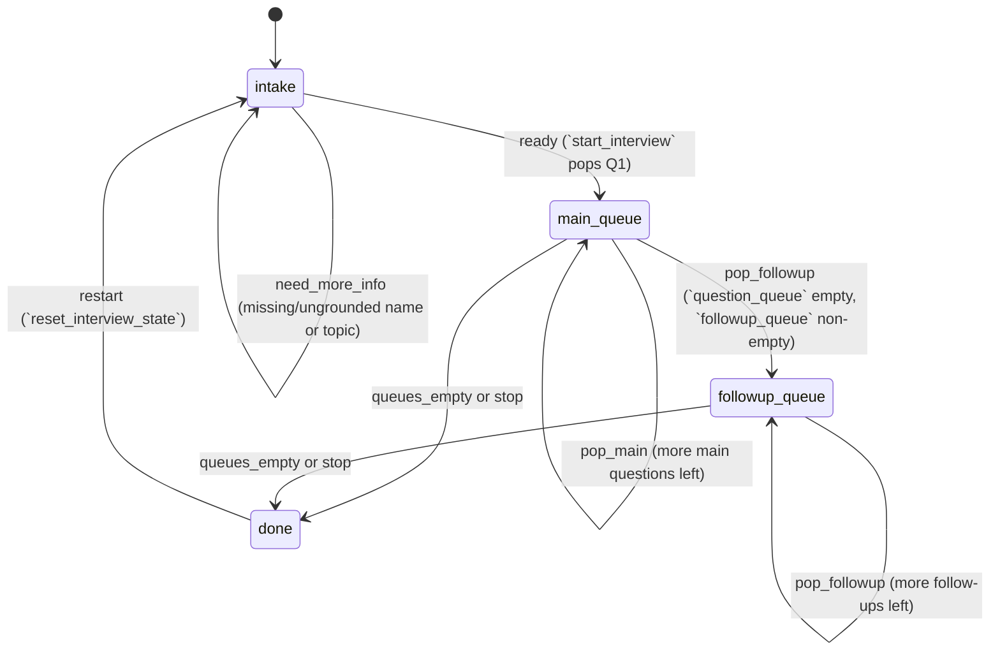

# AGENT_SERVICE.md — Google ADK Two-Queue Harness

The `agent` service (`services/agent/interviewer_app/`) hosts the conversational interviewer built with **Google ADK**. It is served by `adk web` on port `8000`.

---

## 1. Responsibilities

- Conduct multi-turn interviews via a single `LlmAgent` (`interview_orchestrator`).
- Advance the Two-Queue state machine (`shared/contracts/state_machine.py`) deterministically on every user turn via ADK callbacks.
- Restrict which MCP tools the model can see on each turn (`ALLOWED_TOOLS_BY_PHASE`).
- Mirror MCP tool effects directly into ADK session state (`tool_ctx.state`) and `data/<user_id>.json`.

**Must not:** run Hugging Face NLP models, talk to Neo4j, or generate the final analysis summary in chat.

---

## 2. Architecture (`orchestrator.py` + `config.py`)

Instead of multiple sub-agents with `transfer_to_agent`, `build_interview_harness()` wires **one `LlmAgent`** with:

1. **Dynamic instruction (`build_harness_instruction`):** formats `PHASE_PROMPTS[phase]` from `shared/contracts/prompts.py` using live values from `ctx.state` (`user_name`, `topic`, `current_question`, `current_followup_context`, `last_answered_question`, `last_user_answer`, queue counts, etc.).
2. **MCP toolset (`build_mcp_toolset`):** connects over Streamable HTTP to `MCP_SERVER_URL` (`http://mcp:8001/mcp` in Docker) filtering `["start_interview", "push_followup"]`.
3. **Three lifecycle callbacks:**
   - `before_agent_callback=_on_user_turn`
   - `before_model_callback=_filter_tools`
   - `after_tool_callback=_on_tool_result`
4. **Transport resilience:** `RetryConfig(max_attempts=3, initial_delay=0.2, backoff_factor=1.5, jitter=0.0)`.

---

## 3. State Machine & Turn Lifecycle

### Callback Execution Order per User Message

1. **`_on_user_turn(ctx)` (`before_agent_callback`):**
   - Ensures `phase` is initialized (`intake`) and stores optional `num_questions_override`.
   - Looks up `PHASE_USER_TURN_HANDLERS.get(phase)`:
     - In `main_queue` or `followup_queue`: calls `advance_queues_on_user_answer(state, user_text)`:
       - Checks `USER_COMMAND_HANDLERS` (`stop`/`quit`/`exit`/`end` → `done`, `restart`/`new`/`reset` → `intake`).
       - Appends `{source, question, context, answer, answered_at}` to `transcript` (`[skipped]` if `skip`/`pass`/`next`).
       - If in `main_queue` and answer has `< 3` words (and not skipped), auto-queues an elaboration follow-up into `followup_queue`.
       - Runs `QUEUE_POP_STRATEGIES`: pops `question_queue` first (`POP_MAIN`), otherwise `followup_queue` (`POP_FOLLOWUP`), otherwise finishes (`QUEUES_EMPTY` → `phase="done"`, `status="pending_analysis"`, `processed=False`).
     - In `done`: if user says a `RESTART_COMMANDS` word, calls `reset_interview_state(state)`.

2. **`_filter_tools(ctx, llm_request)` (`before_model_callback`):**
   - Strips internal `Part(thought=True)` items from message history (keeping at least non-thought parts) so LiteLLM does not replay reasoning traces as normal text.
   - Computes allowed tools from `ALLOWED_TOOLS_BY_PHASE[phase]`:
     - `intake` → `{"start_interview"}`
     - `main_queue` → `{"push_followup"}` (discarded if `pushed_this_turn` is `True` or `last_user_answer` is empty on Q1)
     - `followup_queue` → `set()`
     - `done` → `set()`
   - Filters `llm_request.config.tools[].function_declarations` and **removes any `Tool` object whose `function_declarations` becomes empty** (preventing OpenRouter/Nvidia `400 Bad Request: missing field 'type'`). Keeps `llm_request.tools_dict` intact so ADK never throws `Tool not found` if a model hallucinates a call.

3. **`_on_tool_result(tool, args, tool_ctx, response)` (`after_tool_callback`):**
   - Dispatches via `TOOL_RESULT_HANDLERS`:
     - `start_interview` → `apply_start_interview_to_state(...)` (verifies name/topic are grounded in `collect_user_messages_text(tool_ctx)`, validates `INTERVIEW_MIN_QUESTIONS`–`INTERVIEW_MAX_QUESTIONS` distinct questions, pops Q1, writes `data/<user_id>.json`).
     - `push_followup` → `apply_push_followup_to_state(...)` (appends `{question, context}` to `followup_queue`, sets `pushed_this_turn=True`, updates `data/<user_id>.json`).

---

## 4. Model Configuration (`config.py`)

Configured via environment variables and `LiteLlm`:

| Env Var | Example | Purpose |
|---|---|---|
| `LLM_MODEL` | `openrouter/nvidia/nemotron-3.5-super-vl:free` or `ollama_chat/mimo-v2.6:9b` | Conversational interviewer model |
| `OLLAMA_API_BASE` | `http://localhost:11434` (`http://host.docker.internal:11434` in Docker) | Base URL for `ollama_chat/...` |
| `LLM_THINKING` | `true` | Controls `think` flag for `qwen3` models |
| `OPENROUTER_API_KEY` | `sk-or-...` | Required for `openrouter/...` |
| `INTERVIEW_MIN_QUESTIONS` / `INTERVIEW_MAX_QUESTIONS` | `3` / `5` | Configurable min & max question bounds (`MIN_QUESTIONS=3`, `MAX_QUESTIONS=5` defaults) |
| `INTERVIEW_NUM_QUESTIONS` | `3` | Optional fixed override for question count |
| `MCP_SERVER_URL` | `http://mcp:8001/mcp` | Remote MCP endpoint |
