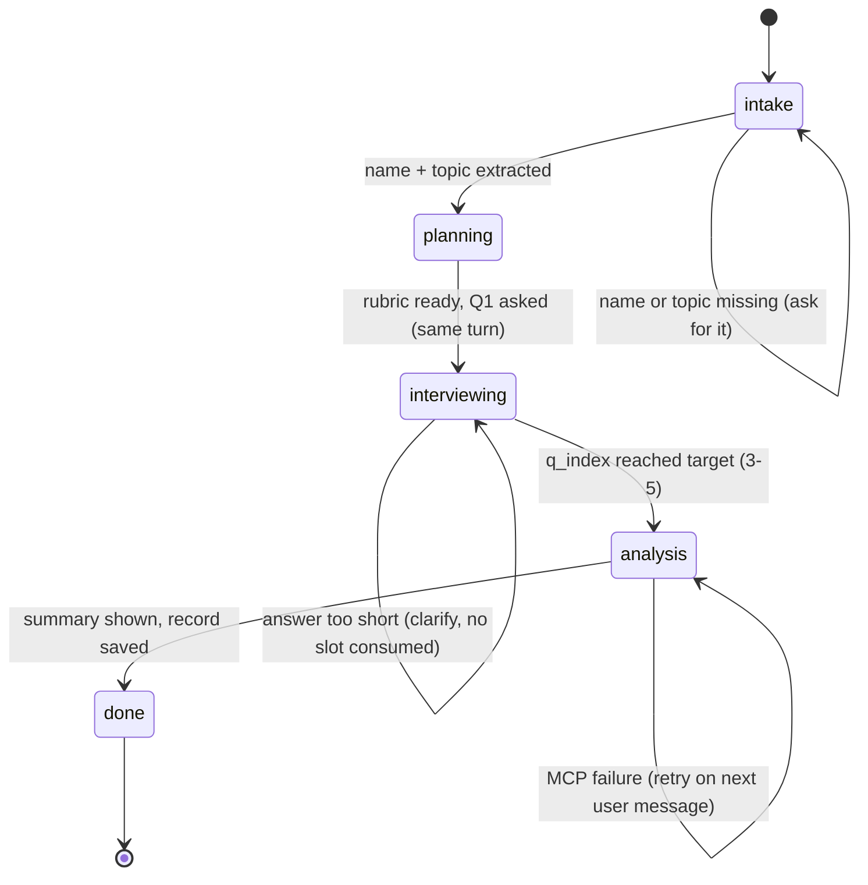

# AGENT_SERVICE.md — Google ADK Harness

The `agent` service hosts the conversational harness built with **Google ADK**. It is served by `adk web` (UI + REST/SSE API) on port `8000`.

---

## 1. Responsibilities

- Run the interview conversation across multiple user turns.
- Drive phase transitions deterministically (state machine).
- Call the LLM (via `LiteLlm`) for judgment tasks only: intake extraction, rubric planning, question generation, summary.
- Call the `mcp` service for NLP enrichment and persistence.
- Render clean, human-readable messages to the user.

**Must not:** import `torch`/`transformers`/`neo4j`, write interview files, or let an LLM decide phase transitions or question count.

---

## 2. Agent Tree

```text
root_agent = InterviewOrchestrator (custom BaseAgent)      # state machine, the only agent the Runner sees
├── IntakeAgent        (LlmAgent, output_schema=IntakeResult)
├── PlannerAgent       (LlmAgent, output_schema=Rubric)
├── InterviewerAgent   (LlmAgent, output_schema=InterviewerTurn)
└── AnalysisPipeline   (SequentialAgent — Stage 2 milestone)
    ├── EnrichmentStep (custom BaseAgent → MCP analyze_answers)
    ├── SummarizerAgent(LlmAgent, output_schema=InterviewSummary)
    └── PersistStep    (custom BaseAgent → MCP save_interview)
```

All sub-agents live in `interviewer_app/agents/` and are registered in `sub_agents=[...]` of the orchestrator (so ADK tracks the hierarchy), but they are **invoked explicitly** from `_run_async_impl`; no `transfer_to_agent`.

---

## 3. State Machine



### Turn algorithm (per incoming user message)

| `phase` | Steps executed in this single turn |
|---|---|
| `intake` | Run `IntakeAgent` on the message (merging with any field already given in a previous turn). If `user_name` or `topic` still missing → ask only for the missing field, stay. Else → set `user_id` (slug of name), `interview_id` (uuid4), then **fall through** to `planning`. |
| `planning` | Run `PlannerAgent` → `rubric` (fallback to a 3-area default rubric if the model fails validation). Compute `target_questions = clamp(len(rubric.areas), 3, 5)`. Run `InterviewerAgent` → Q1. Emit a single welcome message with the rubric + privacy notice + Q1. Set `phase = interviewing`. |
| `interviewing` | Validate the answer (see §6). Append `TranscriptTurn` to `transcript`, `q_index += 1`. If `q_index >= target_questions` (or `q_index >= 3` and the interviewer flagged `coverage_complete`) → `phase = analysis` and **fall through**. Else run `InterviewerAgent` → emit next question. |
| `analysis` | Run `AnalysisPipeline`. On success → emit final report, `phase = done`. On MCP failure → emit error message, stay in `analysis`. |
| `done` | Reply that the interview is finished and suggest starting a new session (`restart`). |

"Fall through" = continue to the next phase inside the same invocation, so the user never has to send a filler message.

---

## 4. Session State

Session-scoped keys (no prefix). Only the orchestrator and steps write them.

| Key | Type | Written by | Notes |
|---|---|---|---|
| `phase` | `"intake" \| "planning" \| "interviewing" \| "analysis" \| "done"` | orchestrator | initialized to `intake` |
| `user_name`, `user_id`, `topic` | `str` | orchestrator (from `IntakeResult`) | |
| `interview_id` | `str` (uuid4) | orchestrator | idempotency key for persistence |
| `rubric` | `Rubric` (dict) | PlannerAgent via `output_key` | |
| `target_questions` | `int` 3–5 | orchestrator | |
| `q_index` | `int` | orchestrator | number of answered questions |
| `pending_question` | `InterviewerTurn` (dict) | InterviewerAgent via `output_key` | question awaiting an answer |
| `clarification_used` | `bool` | orchestrator | reset after each accepted answer |
| `transcript` | `list[TranscriptTurn]` | orchestrator | |
| `rubric_text`, `transcript_text`, `uncovered_areas`, `next_question_number` | `str` / `int` | orchestrator | pre-rendered strings for `{...}` prompt templates |
| `nlp_results` | `AnalyzeAnswersResult` | EnrichmentStep | |
| `summary` | `InterviewSummary` | SummarizerAgent via `output_key` | |
| `persist_result` | `SaveInterviewResult` | PersistStep | |

Schemas: [`DATA_MODEL.md`](DATA_MODEL.md).

### State-update rules (ADK gotchas)
- Persist state changes **through events** (`EventActions(state_delta=...)`); changes are committed by the Runner only when the event is yielded.
- Sub-agents with `output_schema` emit raw JSON as their event text. To keep the chat clean, the orchestrator consumes sub-agent events internally, merges their `actions.state_delta` into `ctx.session.state` **and** into a `pending_delta` dict, then attaches `pending_delta` to the single user-facing markdown event it yields.
- Store plain JSON-serializable dicts in state (`model.model_dump()`), not Pydantic objects.

---

## 5. Sub-Agent Specifications

| Agent | File | `include_contents` | `output_schema` | `output_key` | Reads from state |
|---|---|---|---|---|---|
| IntakeAgent | `agents/intake.py` | `default` (needs the user message) | `IntakeResult` | `intake` | — |
| PlannerAgent | `agents/planner.py` | `none` | `Rubric` | `rubric` | `{topic}` |
| InterviewerAgent | `agents/interviewer.py` | `none` | `InterviewerTurn` | `pending_question` | `{topic}`, `{rubric_text}`, `{transcript_text}`, `{uncovered_areas}`, `{next_question_number}`, `{target_questions}` |
| SummarizerAgent | `agents/summarizer.py` *(later)* | `none` | `InterviewSummary` | `summary` | `{topic}`, `{rubric_text}`, `{transcript_text}`, `{nlp_results}` |

`include_contents="none"` + `{state}` templating means each call receives exactly the context it needs — deterministic, compact, and friendly to small local models.

---

## 6. Answer Validation (deterministic)

| Condition | Action |
|---|---|
| Empty or < 3 words, and `clarification_used = false` | Ask a gentle clarification of the same question, set `clarification_used = true`, no slot consumed |
| Still short after clarification | Accept as-is |
| User types `skip` | Record answer as `"[skipped]"`, excluded from NLP |
| User types `stop` / `end interview` | Jump to `analysis` if `q_index >= 1`, else to `done` without saving |
| User types `restart` (when `done`) | Reset session state and start a fresh interview |

---

## 7. Analysis Pipeline

1. **EnrichmentStep** — builds `[{answer_id, text}]` from `transcript` (skips `[skipped]`), calls MCP `analyze_answers`, writes `nlp_results`.
2. **SummarizerAgent** — LLM summary using rubric + transcript + NLP results.
3. **PersistStep** — assembles `InterviewRecord` (see [`DATA_MODEL.md`](DATA_MODEL.md)), calls MCP `save_interview`, writes `persist_result`.
4. Orchestrator renders the final report.

---

## 8. MCP Integration

- **Transport:** Streamable HTTP, URL from `MCP_SERVER_URL` (default `http://mcp:8001/mcp`), optional `Authorization: Bearer ${MCP_AUTH_TOKEN}` header.
- **Deterministic steps** (`EnrichmentStep`, `PersistStep`) use a thin wrapper in `mcp_client.py` built on the official `mcp` client SDK (`ClientSession.call_tool`).

---

## 9. Model Configuration (`config.py`)

All models go through `google.adk.models.LiteLlm`:

| Env var | Example (local Ollama) | Example (cloud OpenRouter) | Meaning |
|---|---|---|---|
| `LLM_MODEL` | `ollama_chat/qwen3:8b` | `openrouter/qwen/qwen-2.5-72b-instruct` | Model for Intake/Planner/Interviewer |
| `LLM_MODEL_SUMMARY` | *(empty = `LLM_MODEL`)* | `openrouter/anthropic/claude-3.5-haiku` | Optional model for Summarizer |
| `OLLAMA_API_BASE` | `http://localhost:11434` | — | Used for `ollama_chat/...` models |
| `OPENROUTER_API_KEY` | — | `sk-or-...` | Used for `openrouter/...` models |

For Qwen3 on Ollama, `config.py` passes `think=False` so chain-of-thought tags do not corrupt JSON output.

---

## 10. Runtime

- Local dev: `adk web services/agent` (opens `http://localhost:8000`).
- Docker: `adk web --host 0.0.0.0 --port 8000 /app/agents`.
- Healthcheck: `GET /list-apps` returns `["interviewer_app"]`.

---

## 11. Testing

| Level | What | How |
|---|---|---|
| Unit (`tests/test_orchestrator.py`) | Orchestrator transitions, answer validation, clarification, skip/stop, clamp logic | Fake sub-agents returning canned Pydantic models — runs in < 1 s with no LLM |
| Unit (`tests/test_contracts.py`) | Pydantic validation rules (unique rubric areas, score rounding, lowercase keywords) | Direct model tests |
| Interactive CLI (`scripts/try_interview.py`) | Play an interview in the terminal | `--mock` (no LLM) or live against Ollama / OpenRouter |
| Visual (`adk web services/agent`) | Full chat UI + state inspector | Browser at `http://localhost:8000` |
