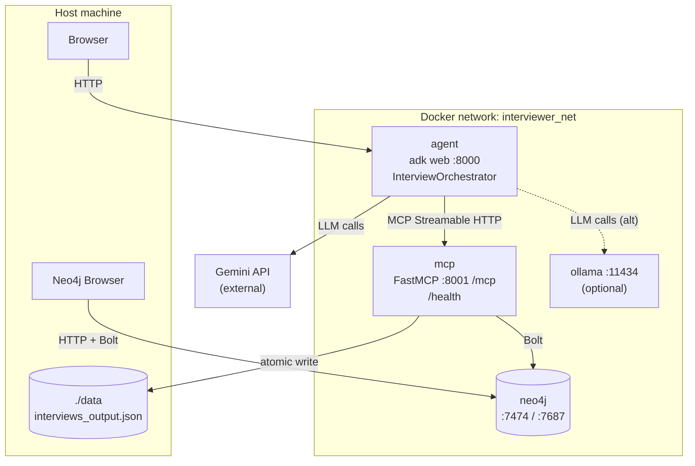
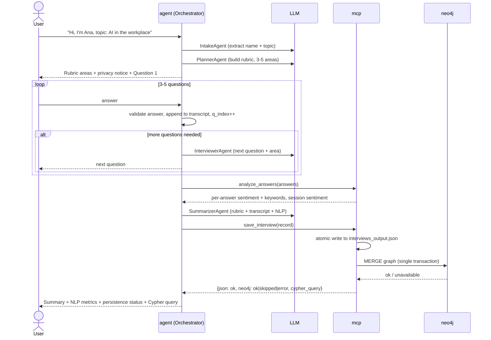

# ARCHITECTURE.md — System Architecture

See [`GOALS.md`](GOALS.md) for requirements. This document describes **how the services fit together**.

---

## 1. Services

| Service | Image | Exposed to host | Internal address | Owns storage |
|---|---|---|---|---|
| `agent` | built from `services/agent` | `8000` (ADK web UI + API) | `http://agent:8000` | `agent_sessions` volume (ADK session DB) |
| `mcp` | built from `services/mcp` | none (optional `8001` in dev for MCP Inspector) | `http://mcp:8001/mcp` | `./data` bind mount, `hf_cache` volume |
| `neo4j` | `neo4j:5-community` | `7474` (Browser), `7687` (Bolt) | `bolt://neo4j:7687` | `neo4j_data`, `neo4j_logs` volumes |
| `ollama` *(optional, profile `local-llm`)* | `ollama/ollama` | none | `http://ollama:11434` | `ollama_models` volume |

All services share one user-defined bridge network: `interviewer_net`.

---

## 2. Topology

### Communication matrix

| From → To | Protocol | Purpose | Failure handling |
|---|---|---|---|
| Browser → agent | HTTP / SSE (`adk web`) | Chat UI | — |
| agent → LLM | HTTPS (Gemini) or HTTP (Ollama via LiteLLM) | Intake, planning, questions, summary | Retry with backoff (max 2); then apologetic message, state unchanged |
| agent → mcp | MCP over Streamable HTTP | NLP + persistence tools | Timeout 60 s for NLP, 30 s for save; 1 retry; surfaced to user if still failing |
| mcp → neo4j | Bolt | Graph ingestion | Non-fatal; record saved with `neo4j_synced: false` |
| mcp → disk | File I/O | JSON persistence | Fatal for `save_interview` (returns error status) |

---

## 3. Responsibility Boundaries

- **agent** is the only service that talks to an LLM and the only one that keeps conversation state.
- **mcp** is the only service that touches `data/` and Neo4j, and the only one with ML dependencies.
- **neo4j** is passive storage; schema constraints are created by `mcp` at startup (idempotent).
- Contracts between `agent` and `mcp` are the MCP tool signatures in [`MCP_SERVICE.md`](MCP_SERVICE.md) and the schemas in [`DATA_MODEL.md`](DATA_MODEL.md). Each service keeps its own copy of the Pydantic models; a contract test guards drift.

---

## 4. End-to-End Flow (one interview)

---

## 5. Failure Modes

| Scenario | Expected behavior |
|---|---|
| Neo4j down or not configured | `mcp` starts anyway (health reports `neo4j: down`); `save_interview` writes JSON, returns `neo4j.status = "skipped"`; user sees a warning line |
| `mcp` down at agent startup | `agent` waits (Compose `depends_on: service_healthy`) |
| `mcp` down mid-interview | Questions continue (no MCP needed); at analysis, retry once, then tell the user analysis failed and keep `phase = analysis` so the next message retries |
| LLM returns invalid structured output | Pydantic validation fails → one re-prompt with the validation error; then deterministic fallback (e.g., generic question for the next uncovered area) |
| User sends empty / one-word answer | One clarification request that does **not** consume a question slot |
| Agent container restarts mid-interview | Session restored from `agent_sessions` (SQLite via `DatabaseSessionService`); orchestrator resumes from `phase` |
| Duplicate save (retry after timeout) | Idempotent: `interview_id` is the key in JSON and in Neo4j `MERGE` |

---

## 6. Key Design Decisions

| # | Decision | Rationale | Alternatives rejected |
|---|---|---|---|
| D1 | Separate `mcp` microservice for tools | Isolates heavy ML deps, models loaded once and kept warm, independently scalable/testable, reusable by other MCP clients | In-process `FunctionTool`s (bloats agent image, couples lifecycles) |
| D2 | MCP over **Streamable HTTP** (not stdio) | Containers cannot spawn each other's processes; HTTP is the standard remote MCP transport | stdio (only works in one container), SSE (legacy) |
| D3 | Custom `BaseAgent` orchestrator as a **state machine** | Interviews span many user turns; `SequentialAgent`/`LoopAgent` run to completion in one turn; LLM-driven transfer is non-deterministic | `SequentialAgent`, `LoopAgent`, LLM coordinator with `transfer_to_agent` |
| D4 | NLP + persistence called **deterministically** from code | Guarantees exactly-once execution; avoids `output_schema` + tools conflicts | LLM deciding when to call tools |
| D5 | JSON-first, Neo4j best-effort with `neo4j_synced` flag | Meets "simple storage" requirement unconditionally; graph can be re-synced later | Neo4j as source of truth |
| D6 | Models baked into the `mcp` image at build time | Fast, offline, deterministic startup | Download on first request (slow, needs internet at runtime) |
| D7 | Sub-agents use `include_contents="none"` + state templating | Each LLM call gets exactly the context it needs; smaller prompts, works with small local models | Full conversation history in every call |
