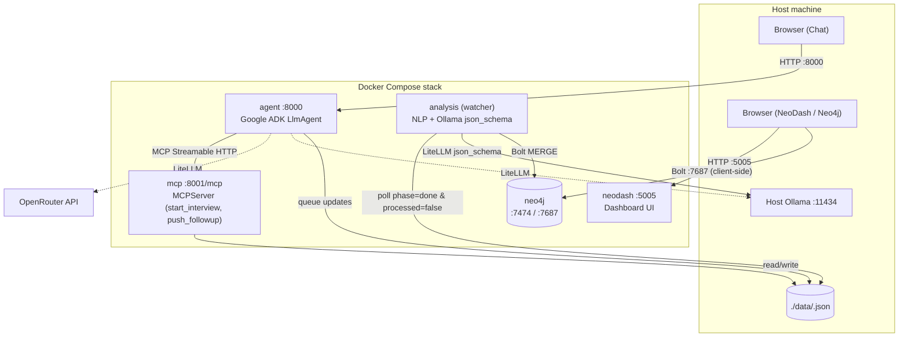
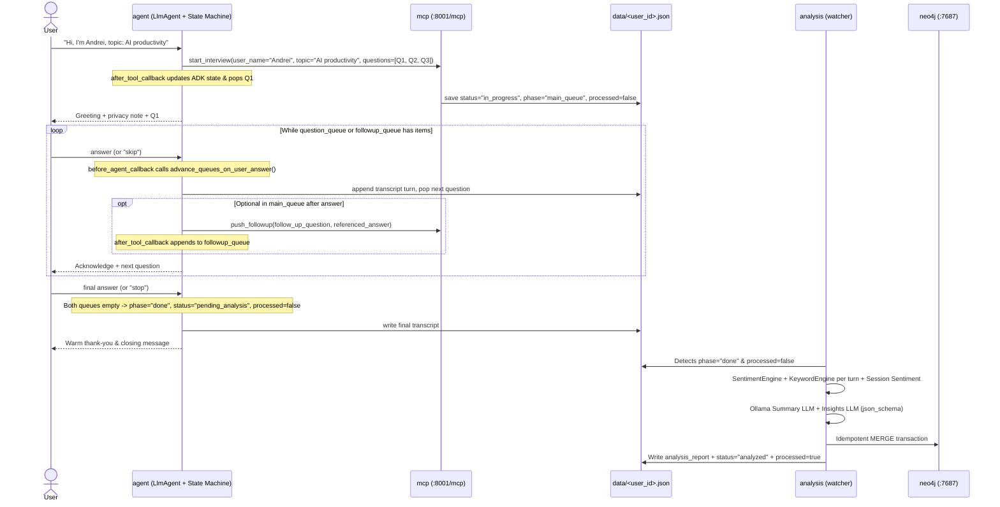

# ARCHITECTURE.md — System Architecture

See [`GOALS.md`](GOALS.md) for requirements. This document describes **how the 5 services fit together**.

---

## 1. Services

| Service | Image / Build | Host Port | Internal Address | Owns / Mounts |
|---|---|---|---|---|
| `agent` | `./services/agent` | `8000` (ADK Web UI) | `http://agent:8000` | `./data:/app/data`, ADK session DB |
| `mcp` | `./services/mcp` | `8001` (Streamable HTTP) | `http://mcp:8001/mcp` | `./data:/app/data` |
| `analysis` | `./services/analysis` | — (worker) | — | `./data:/app/data` |
| `neo4j` | `neo4j:5-community` | `7474` (Browser), `7687` (Bolt) | `bolt://neo4j:7687` | `neo4j_data`, `neo4j_logs` volumes |
| `neodash` | `neo4jlabs/neodash:latest` | `5005` (Dashboard UI) | `http://neodash:5005` | Browser connects to `bolt://localhost:7687` |

---

## 2. Topology

### Communication matrix

| From → To | Protocol | Purpose | Failure handling |
|---|---|---|---|
| Browser → `agent` | HTTP / SSE (`adk web`) | Conversational UI & session state | ADK `RetryConfig` (3 attempts) on node errors |
| `agent` → Chat LLM | HTTPS (OpenRouter) or HTTP (Ollama) | Intake extraction, question phrasing, follow-up decision | `_filter_tools` strips empty `Tool` wrappers & `thought` parts to prevent 400 errors |
| `agent` → `mcp` | MCP Streamable HTTP (`/mcp`) | Invoke `start_interview` and `push_followup` | Tool availability strictly gated per phase via `ALLOWED_TOOLS_BY_PHASE` |
| `mcp` & `agent` → `./data` | File I/O | Persist `data/<user_id>.json` | Written after every phase transition & queue pop |
| `analysis` → `./data` | File polling (`5s`) | Detect `phase == "done"` and `processed == False` | Skips `in_progress` and already `processed: True` files |
| `analysis` → Ollama | HTTP (`OLLAMA_API_BASE`) | Raw JSON outputs for Summary & Emotion/Insights | Grammar-constrained via `response_format={"type": "json_schema", ...}` |
| `analysis` → `neo4j` | Bolt (`bolt://neo4j:7687`) | Idempotent graph `MERGE` | Non-fatal: saves JSON with `neo4j_synced: false` and retries later |

---

## 3. End-to-End Flow (One Interview)

---

## 4. Key Design Decisions

| # | Decision | Rationale |
|---|---|---|
| D1 | **Two-Queue deterministic state machine** (`question_queue` → `followup_queue` → `done`) | Eliminates LLM drift in question counting and guarantees follow-ups happen only after main questions finish |
| D2 | **Single `LlmAgent` + ADK callbacks** (`_on_user_turn`, `_filter_tools`, `_on_tool_result`) | Keeps ADK Web UI event stream unified while enforcing Python state transitions and per-phase tool visibility |
| D3 | **Empty `Tool` stripping in `_filter_tools`** | ADK's `lite_llm.py` serializes `Tool(function_declarations=[])` without `"type": "function"`, causing OpenRouter/Nvidia 400 errors; removing empty `Tool` entries while keeping `tools_dict` intact solves both 400s and `Tool not found` warnings |
| D4 | **Status/flag-driven async analysis (`processed: false/true`)** | Completely separates fast conversational turns from slower NLP + local Ollama analysis (`services/analysis`) without file-hash sidecars |
| D5 | **Grammar-constrained `json_schema` + raw output storage** | Prevents Pydantic `ValidationError` drops on local Ollama models by enforcing JSON fields at token-sampling time and storing raw JSON |
| D6 | **Independent LLM configs** (`LLM_MODEL` vs `ANALYSIS_LLM_MODEL` / `LLM_MODEL_SUMMARY` / `LLM_MODEL_INSIGHTS`) | Conversational agent can use fast cloud OpenRouter while post-interview analysis uses local Ollama models (`mimo-v2.6:9b` + `qwen3:1.7b`) |
