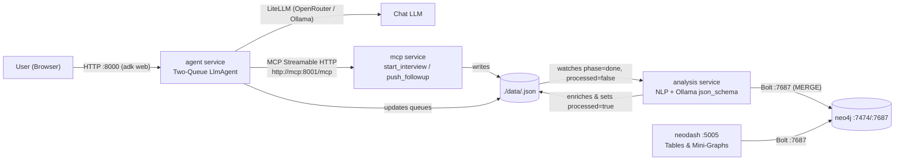

# GOALS.md — Mini AI Interviewer (Dockerized Microservices)

> **Entry point for every contributor / coding agent.** Read this file first, then the linked specs.

## 0. Documentation Map

| File | Purpose |
|---|---|
| [`GOALS.md`](GOALS.md) | Objective, requirements, architecture overview, repo structure (this file) |
| [`ARCHITECTURE.md`](ARCHITECTURE.md) | Service topology, communication matrix, end-to-end flow, failure modes |
| [`AGENT_SERVICE.md`](AGENT_SERVICE.md) | Google ADK Two-Queue `LlmAgent` harness, callbacks, state-machine integration |
| [`MCP_SERVICE.md`](MCP_SERVICE.md) | MCP Streamable HTTP tools server (`start_interview`, `push_followup`) + `analysis` NLP/LLM pipeline |
| [`DATA_MODEL.md`](DATA_MODEL.md) | Shared Pydantic contracts, `data/<user_id>.json` lifecycle, Neo4j graph schema |
| [`DEPLOYMENT.md`](DEPLOYMENT.md) | Docker Compose setup (`neo4j`, `neodash`, `mcp`, `agent`, `analysis`), env vars, commands |
| [`ROADMAP.md`](ROADMAP.md) | Implementation milestones & verification status |

**Precedence when documents disagree:** `shared/contracts/` & source code > `DATA_MODEL.md` > service specs > `ARCHITECTURE.md` > `GOALS.md`.

---

## 1. Project Objective

Build an interactive **Mini AI Interviewer** inspired by *Anthropic Interviewer* — a **qualitative research / thematic exploration tool**.

The application conducts short, adaptive Two-Queue interviews (3–5 main questions + up to 3 contextual follow-up questions) on a user-selected topic, saves each participant's transcript to `data/<user_id>.json`, automatically enriches completed interviews using NLP + local Ollama LLMs, syncs the knowledge graph into **Neo4j**, and visualizes tables & mini-graphs in **NeoDash**.

The system runs as **five Docker services** (`agent`, `mcp`, `analysis`, `neo4j`, `neodash`) started with a single `docker compose up -d --build`.

---

## 2. Functional Requirements

1. **Session initialization (`intake`)** — The user provides their name and discussion topic (e.g., *"AI productivity"*).
2. **Two-Queue interview (`main_queue` → `followup_queue`)**
   - `start_interview` generates 3–5 open-ended main questions, pops Question 1, and creates `data/<user_id>.json` (`status = "in_progress"`, `processed = False`).
   - On each user answer, deterministic Python code pops the next question from `question_queue`; when `question_queue` is empty, it pops any queued questions from `followup_queue` before finishing.
   - Users can type `skip` / `pass` / `next`, `stop` / `quit` / `exit` / `end`, or `restart` / `new` / `reset` anytime.
3. **Completion trigger** — When both queues are empty (or user stops with answers), the state machine sets `phase = "done"`, `status = "pending_analysis"`, `processed = False`.
4. **Post-interview analysis (`services/analysis`)** — Automatically picks up `phase == "done"` and `processed == False` files:
   - Per-answer NLP sentiment + keyphrase extraction + aggregated `session_sentiment`.
   - Full-transcript `summary` and `emotion_and_insights` via Ollama (`json_schema` grammar-constrained outputs, saved raw).
   - Marks `status = "analyzed"`, `processed = True`.
5. **Knowledge graph + Dashboard** — Syncs nodes/relationships into Neo4j (`MERGE` idempotent) and exposes interactive tables, charts, and mini-graphs via NeoDash (`services/analysis/dashboards/dashboard.json`).

---

## 3. Architecture at a Glance



### Guiding principles
1. **LLM for language, Python for state & queues.** The LLM decides question phrasing and when to suggest a `push_followup`. Phase transitions (`STATE_MACHINE_TRANSITIONS`), queue popping (`QUEUE_POP_STRATEGIES`), command handling (`USER_COMMAND_HANDLERS`), and tool exposure (`ALLOWED_TOOLS_BY_PHASE`) are 100% deterministic Python in `shared/contracts/state_machine.py`.
2. **Prompts in one place.** Every agent phase prompt and analysis prompt lives in `shared/contracts/prompts.py`.
3. **Decoupled LLM models.** The conversational agent (`LLM_MODEL`) and the post-interview analysis pipeline (`ANALYSIS_LLM_MODEL`, `LLM_MODEL_SUMMARY`, `LLM_MODEL_INSIGHTS`) are configured independently.
4. **JSON first, Neo4j second.** `data/<user_id>.json` is the source of truth; `neo4j_synced: false` records are automatically retried on the next analysis cycle if Neo4j was temporarily offline.

---

## 4. Repository Structure

```text
Yonder/
├── .agents/                          # Architecture & service specs
├── docker-compose.yml                # neo4j, neodash, mcp, agent, analysis
├── sample.env                        # Env template
├── .env                              # Local env (git-ignored)
├── pytest.ini
├── requirements-dev.txt
├── data/                             # Bind-mounted runtime JSON files (<user_id>.json) + guides
│   
├── shared/
│   ├── pyproject.toml
│   └── contracts/                    # Single source of truth across services
│       ├── __init__.py
│       ├── common.py                 # SKIPPED_ANSWER, Score, SentimentLabel, utc_now_iso
│       ├── llm_outputs.py            # IntakeResult, InterviewSummary, EmotionToneAnalysis
│       ├── nlp.py                    # Sentiment, Keyword, AnswerAnalysis
│       ├── prompts.py                # PHASE_PROMPTS + Analysis prompts
│       └── state_machine.py          # Two-Queue transitions, commands, JSON persistence
├── services/
│   ├── agent/                        # Google ADK web UI (:8000)
│   │   ├── Dockerfile
│   │   ├── requirements.txt
│   │   └── interviewer_app/
│   │       ├── __init__.py
│   │       ├── agent.py              # exposes root_agent
│   │       ├── config.py             # AgentSettings & build_llm (LiteLlm)
│   │       └── orchestrator.py       # build_interview_harness + callbacks + dispatch maps
│   ├── mcp/                          # Streamable HTTP MCP server (:8001)
│   │   ├── Dockerfile
│   │   ├── requirements.txt
│   │   └── mcp_server/
│   │       ├── __init__.py
│   │       └── server.py             # start_interview & push_followup MCP tools
│   └── analysis/                     # Background watcher + NLP/LLM + Neo4j sync
│       ├── Dockerfile
│       ├── requirements.txt
│       ├── dashboards/
│       │   └── dashboard.json        # Unified NeoDash export (2 pages, 16 cards)
│       └── analysis_app/
│           ├── __init__.py
│           ├── __main__.py           # CLI (`--watch`, `--force`)
│           ├── config.py             # AnalysisSettings
│           ├── nlp_models.py         # SentimentEngine & KeywordEngine
│           ├── llm_analyzers.py      # Grammar-constrained JSON Schema Ollama/LiteLLM calls
│           ├── neo4j_store.py        # Idempotent MERGE Cypher sync
│           └── pipeline.py           # AnalysisPipeline & status/processed watcher
└── tests/
    ├── test_contracts.py
    ├── test_orchestrator.py
    └── test_analysis_pipeline.py
```
