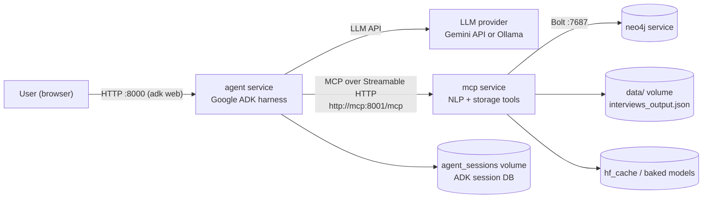

# GOALS.md — Mini AI Interviewer (Anthropic Interviewer–style, Dockerized Microservices)

> **Entry point for every contributor / coding agent.** Read this file first, then the linked specs.

## 0. Documentation Map

| File | Purpose |
|---|---|
| [`GOALS.md`](GOALS.md) | Objective, requirements, high-level architecture, acceptance criteria (this file) |
| [`ARCHITECTURE.md`](ARCHITECTURE.md) | Service topology, communication, data flow, failure modes, design decisions |
| [`AGENT_SERVICE.md`](AGENT_SERVICE.md) | Google ADK harness: orchestrator state machine, sub-agents, session state, MCP client |
| [`MCP_SERVICE.md`](MCP_SERVICE.md) | MCP server: tool contracts, Hugging Face NLP, JSON + Neo4j persistence |
| [`DATA_MODEL.md`](DATA_MODEL.md) | Pydantic schemas, JSON file format, Neo4j graph schema, Cypher queries |
| [`DEPLOYMENT.md`](DEPLOYMENT.md) | Docker Compose services, env vars, volumes, healthchecks, run commands |
| [`ROADMAP.md`](ROADMAP.md) | Implementation milestones with per-milestone acceptance checks |

**Precedence when documents disagree:** `DATA_MODEL.md` (contracts) > service specs > `ARCHITECTURE.md` > `GOALS.md`. Fix the inconsistency in the same change.

---

## 1. Project Objective

Build an interactive **Mini AI Interviewer** inspired by the *Anthropic Interviewer* architecture — a **qualitative research / thematic exploration tool, NOT a recruitment or HR tool**.

The application conducts short, adaptive interviews (3–5 sequential questions) on a user-selected topic, enriches the answers with dedicated Hugging Face NLP models, produces an AI-generated summary, and persists everything to a local JSON file **and** a Neo4j knowledge graph.

The system runs as **three Docker microservices** (agent, MCP tools server, Neo4j) plus persistent storage volumes, started with a single `docker compose up`.

---

## 2. Functional Requirements (Core + Bonus)

1. **Session initialization** — The user provides a name/ID and a discussion topic (e.g., *"AI in the workplace"*, *"productivity tools"*, *"scientific research"*).
2. **Sequential question generation** — The system generates **3–5** open-ended questions, one at a time, each adapted to the topic, the interview rubric, and the user's previous answers.
3. **Interactive collection** — Answers are collected turn-by-turn in a natural conversation.
4. **Post-interview summary** — A structured AI-generated summary: key themes, overall sentiment, key points, illustrative quotes.
5. **Dual persistence**
   - Every completed session (transcript + summary + NLP scores) is appended to `data/interviews_output.json` (always succeeds if the disk is writable).
   - Entities and relationships are synchronized into **Neo4j** for graph visualization (best-effort, see graceful degradation).
6. **Bonus — dedicated Hugging Face models**
   - Sentiment scoring per answer and per session.
   - Keyword / keyphrase extraction per answer.

---

## 3. Architecture at a Glance



| Service | Responsibility | Never does |
|---|---|---|
| **agent** | Conversation, orchestration (state machine), LLM calls, summary generation | Load ML models, talk to Neo4j, write interview files |
| **mcp** | Deterministic tools: sentiment, keywords, JSON persistence, Neo4j ingestion | Call an LLM, hold conversation state |
| **neo4j** | Knowledge graph storage + Browser UI (`:7474`) | — |

### Guiding principles
1. **LLM for judgment, code for control.** LLMs phrase questions and write summaries. Counting questions, phase transitions, tool invocation order and persistence are deterministic Python.
2. **Clear service boundaries.** The agent reaches data *only* through MCP tools. Heavy dependencies (`torch`, `transformers`, `neo4j`) live only in the MCP image.
3. **JSON first, graph second.** The JSON write is the source of truth; Neo4j is a best-effort projection that can be re-synced.
4. **Contracts are explicit.** All cross-service payloads are defined in [`DATA_MODEL.md`](DATA_MODEL.md) and validated with Pydantic on both sides.

---

## 4. Non-Functional Requirements

| Area | Requirement |
|---|---|
| Startup | `docker compose up --build` starts the full stack; no manual steps besides creating `.env` |
| Resilience | Neo4j offline/misconfigured → warning logged, JSON still saved, interview completes normally |
| Determinism | Question count always within 3–5; NLP + persistence always executed exactly once per completed interview |
| Privacy | Privacy notice shown before the first question; users are asked not to share PII |
| Portability | CPU-only inference; runs on Docker Desktop (Windows/WSL2) with ~6 GB RAM allocated |
| Configuration | All secrets/endpoints via environment variables; nothing hard-coded |
| Observability | Structured logs per service; `/health` endpoints used by Compose healthchecks |
| Language | Default models are English. Multilingual models are configurable (see [`MCP_SERVICE.md`](MCP_SERVICE.md)) |

---

## 5. Tech Stack

| Layer | Choice |
|---|---|
| Agent framework | `google-adk` (custom `BaseAgent` orchestrator + `LlmAgent` sub-agents) |
| LLM | Configurable: Gemini (`gemini-2.5-flash`) via `GOOGLE_API_KEY`, or local Ollama via `LiteLlm` |
| Tool protocol | MCP (official `mcp` Python SDK, `FastMCP`, Streamable HTTP transport) |
| NLP | `transformers`, `torch` (CPU), `keybert`, `sentence-transformers` |
| Graph DB | Neo4j 5 Community + official `neo4j` Python driver |
| Validation | `pydantic` v2 |
| Runtime | Python 3.12 slim images, Docker Compose v2 |

---

## 6. Repository Structure

```text
Yonder/                               # repo root
├── .agents/                          # specs (this folder)
├── docker-compose.yml
├── .env.example
├── README.md                         # quick start, architecture summary, Cypher queries
├── data/                             # bind-mounted into mcp → interviews_output.json
├── services/
│   ├── agent/
│   │   ├── Dockerfile
│   │   ├── requirements.txt          # google-adk, litellm, mcp, pydantic, python-dotenv
│   │   └── interviewer_app/          # ADK agent package (discovered by `adk web`)
│   │       ├── __init__.py
│   │       ├── agent.py              # exposes root_agent
│   │       ├── orchestrator.py       # InterviewOrchestrator (custom BaseAgent, state machine)
│   │       ├── sub_agents.py         # Intake, Planner, Interviewer, Summarizer LlmAgents
│   │       ├── steps.py              # EnrichmentStep, PersistStep (custom agents calling MCP)
│   │       ├── mcp_client.py         # thin MCP client wrapper (Streamable HTTP)
│   │       ├── prompts.py
│   │       ├── schemas.py            # mirrors DATA_MODEL.md
│   │       └── config.py
│   └── mcp/
│       ├── Dockerfile
│       ├── requirements.txt          # mcp, torch (cpu), transformers, keybert, sentence-transformers, neo4j, pydantic
│       └── mcp_server/
│           ├── __init__.py
│           ├── server.py             # FastMCP app, tool registration, /health
│           ├── config.py
│           ├── schemas.py            # mirrors DATA_MODEL.md
│           ├── nlp/
│           │   ├── sentiment.py
│           │   └── keywords.py
│           ├── storage/
│           │   ├── json_store.py
│           │   └── neo4j_store.py
│           ├── seed_demo.py
│           └── download_models.py    # used at image build time
└── tests/
    ├── agent/
    ├── mcp/
    └── e2e/
```

> `my_agent/` is the initial ADK prototype. It is superseded by `services/agent/interviewer_app/` and should be removed once milestone M3 is done. Never commit `.env` files.

---

## 7. Acceptance Criteria (Definition of Done)

- [ ] `docker compose up --build` brings up `agent`, `mcp`, `neo4j`; all healthchecks pass.
- [ ] Opening `http://localhost:8000` and starting a chat runs a full interview: intake → rubric + privacy notice → 3–5 questions → summary.
- [ ] Each question is mapped to a rubric area; follow-ups reference the previous answer.
- [ ] Final message shows: themes, overall sentiment, key points, quotes, per-answer sentiment + keywords, persistence status, and a ready-to-run Cypher query.
- [ ] `data/interviews_output.json` contains the full record (schema in [`DATA_MODEL.md`](DATA_MODEL.md)).
- [ ] Neo4j contains the interview graph; `MATCH (n)-[r]->(m) RETURN n, r, m` shows it.
- [ ] Stopping `neo4j` and running an interview still completes and saves JSON with `neo4j_synced: false`.
- [ ] Seed command loads 2–3 demo interviews with overlapping users, areas and keywords.
- [ ] Unit tests for NLP aggregation, JSON store, orchestrator transitions; one e2e test with a stubbed LLM.

---

## 8. Out of Scope

- Candidate evaluation, hiring decisions, or any HR scoring.
- Authentication / multi-tenant user management (single local user context).
- Production cloud deployment (local Docker only; design should not prevent it).
- Voice input/output.
