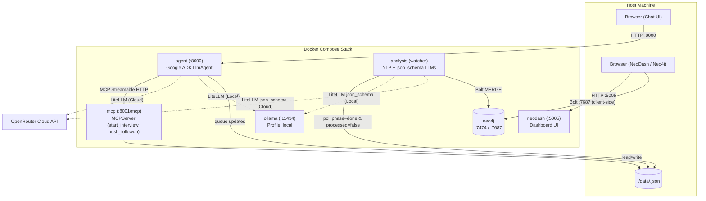
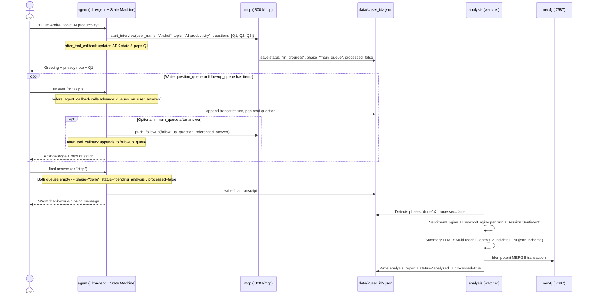
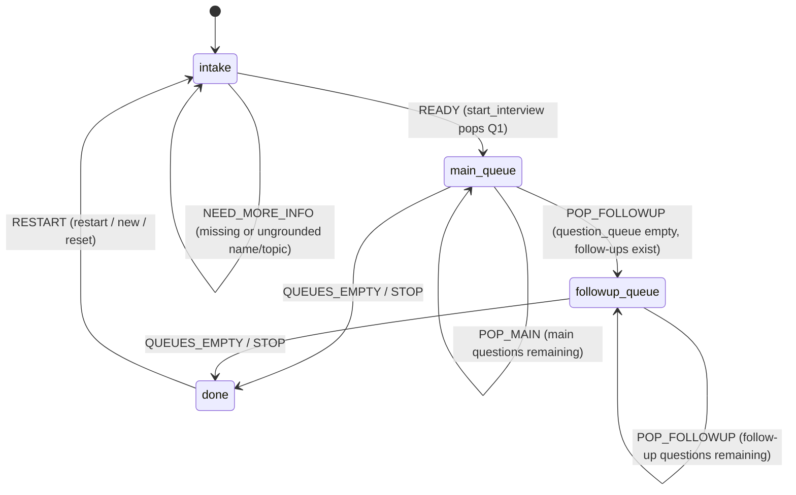
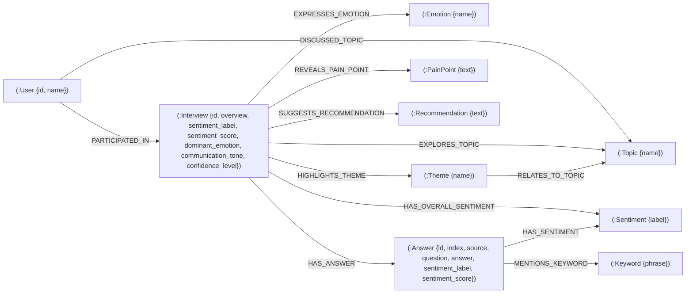

# Mini AI Interviewer

An interactive, qualitative-research **AI Interviewer** inspired by *Anthropic Interviewer*, built as a containerized Docker Compose stack (**Google ADK**, **MCP over Streamable HTTP**, **Local NLP + Multi-Model LLM Analysis**, **Neo4j**, **NeoDash**, and an optional **Ollama** container for 100% local execution).

Its core design principle is **"LLM for language, Python for control"**: the conversational LLM handles empathy, phrasing, and follow-up suggestions, while deterministic Python code controls every phase transition, question queue, tool visibility gate, JSON persistence, and graph synchronization.

---

## Table of Contents

- [1. Architecture & System Topology](#1-architecture--system-topology)
  - [1.1 Service Overview & Repository Structure](#11-service-overview--repository-structure)
  - [1.2 System Topology & Communication Matrix](#12-system-topology--communication-matrix)
  - [1.3 End-to-End Interview Lifecycle](#13-end-to-end-interview-lifecycle)
  - [1.4 Key Design Decisions](#14-key-design-decisions)
- [2. Live Interview Engine](#2-live-interview-engine)
  - [2.1 Two-Queue State Machine (`shared/contracts/state_machine.py`)](#21-two-queue-state-machine-sharedcontractsstate_machinepy)
  - [2.2 Queue Pop Strategies, User Commands & Auto-Clarification](#22-queue-pop-strategies-user-commands--auto-clarification)
  - [2.3 Lifecycle of `data/<user_id>.json`](#23-lifecycle-of-datauser_idjson)
  - [2.4 Google ADK Orchestrator & Callbacks (`services/agent`)](#24-google-adk-orchestrator--callbacks-servicesagent)
  - [2.5 MCP Tools Server (`services/mcp`)](#25-mcp-tools-server-servicesmcp)
- [3. Post-Interview Analysis Pipeline](#3-post-interview-analysis-pipeline)
  - [3.1 Watcher Trigger & Readiness Check (`pipeline.py`)](#31-watcher-trigger--readiness-check-pipelinepy)
  - [3.2 Local NLP Engines (`nlp_models.py`)](#32-local-nlp-engines-nlp_modelspy)
  - [3.3 Structured LLMs & Multi-Model Context Engineering (`llm_analyzers.py`)](#33-structured-llms--multi-model-context-engineering-llm_analyzerspy)
  - [3.4 Inspecting Results & Live Logs](#34-inspecting-results--live-logs)
- [4. Data Contracts, Neo4j Knowledge Graph & NeoDash](#4-data-contracts-neo4j-knowledge-graph--neodash)
  - [4.1 Shared Pydantic Contracts & Enriched JSON Format](#41-shared-pydantic-contracts--enriched-json-format)
  - [4.2 Neo4j Graph Schema (`neo4j_store.py`)](#42-neo4j-graph-schema-neo4j_storepy)
  - [4.3 NeoDash Analytics Dashboard (`http://localhost:5005`)](#43-neodash-analytics-dashboard-httplocalhost5005)
  - [4.4 Cypher Queries for Neo4j Browser (`http://localhost:7474`)](#44-cypher-queries-for-neo4j-browser-httplocalhost7474)
- [5. Testing & Prompt Inspection](#5-testing--prompt-inspection)
- [6. Deployment & Configuration](#6-deployment--configuration)
  - [6.1 Prerequisites](#61-prerequisites)
  - [6.2 Option A — Local Deployment (100% Ollama via Docker)](#62-option-a--local-deployment-100-ollama-via-docker)
  - [6.3 Option B — Cloud Deployment (100% OpenRouter via LiteLLM)](#63-option-b--cloud-deployment-100-openrouter-via-litellm)
  - [6.4 Option C — Hybrid Deployment (OpenRouter + Containerized Ollama)](#64-option-c--hybrid-deployment-openrouter--containerized-ollama)
  - [6.5 Environment Variables Reference](#65-environment-variables-reference)
  - [6.6 Starting, Verifying & Operating the Stack](#66-starting-verifying--operating-the-stack)

---

## 1. Architecture & System Topology

### 1.1 Service Overview & Repository Structure

The system is orchestrated by [`docker-compose.yml`](docker-compose.yml):

| Service | Container | Host Port | Internal Address | Role |
|---|---|---|---|---|
| `agent` | `interviewer-agent` | `8000` | `http://agent:8000` | Google ADK Web UI + Two-Queue `LlmAgent` |
| `mcp` | `interviewer-mcp` | `8001` | `http://mcp:8001/mcp` | Streamable HTTP MCP server (`start_interview`, `push_followup`) |
| `analysis` | `interviewer-analysis` | — (watcher) | — | Post-interview NLP + Structured LLM + Neo4j sync worker |
| `neo4j` | `interviewer-neo4j` | `7474`, `7687` | `bolt://neo4j:7687` | Neo4j 5 Community knowledge graph database |
| `neodash` | `interviewer-neodash` | `5005` | `http://neodash:5005` | Interactive KPI, chart, table, and mini-graph dashboards |
| `ollama` *(profile: `local`)* | `interviewer-ollama` | `11434` | `http://ollama:11434` | Containerized Ollama server with pre-pulled `OLLAMA_MODELS` |

```text
ai-interviewer/
├── .agents/                          # Architecture & service specs
├── docker-compose.yml                # ollama (profile: local), neo4j, neodash, mcp, agent, analysis
├── sample-local.env                  # 100% Ollama environment template (COMPOSE_PROFILES=local)
├── sample-cloud.env                  # 100% OpenRouter environment template (no Ollama needed)
├── sample-hybrid.env                 # Hybrid OpenRouter + containerized Ollama template
├── .env                              # Active local configuration (git-ignored)
├── pytest.ini
├── requirements-dev.txt
├── ollama/
│   └── Dockerfile                    # Pre-pulls OLLAMA_MODELS (mimo-v2.6:9b, qwen3:1.7b)
├── scripts/
│   ├── run_tests.ps1                 # PowerShell test runner (Windows)
│   └── run_tests.sh                  # Bash test runner (Linux/macOS/Git Bash)
├── data/                             # Bind-mounted runtime JSON files (<user_id>.json)
├── shared/
│   ├── pyproject.toml
│   └── contracts/                    # Single source of truth shared across services
│       ├── __init__.py
│       ├── common.py                 # SKIPPED_ANSWER, Score, SentimentLabel, utc_now_iso
│       ├── llm_outputs.py            # IntakeResult, InterviewSummary, EmotionToneAnalysis
│       ├── nlp.py                    # Sentiment, Keyword, AnswerAnalysis
│       ├── prompts.py                # PHASE_PROMPTS + Analysis prompts
│       └── state_machine.py          # Two-Queue transitions, commands, JSON persistence
├── services/
│   ├── agent/                        # Google ADK web UI (:8000)
│   │   ├── Dockerfile
│   │   ├── requirements.txt
│   │   └── interviewer_app/
│   │       ├── __init__.py
│   │       ├── agent.py              # Exposes root_agent for `adk web`
│   │       ├── config.py             # AgentSettings & build_llm (LiteLlm)
│   │       └── orchestrator.py       # build_interview_harness + callbacks + dispatch maps
│   ├── mcp/                          # Streamable HTTP MCP server (:8001)
│   │   ├── Dockerfile
│   │   ├── requirements.txt
│   │   └── mcp_server/
│   │       ├── __init__.py
│   │       └── server.py             # start_interview & push_followup MCP tools
│   └── analysis/                     # Background watcher + NLP/LLM + Neo4j sync
│       ├── Dockerfile
│       ├── requirements.txt
│       ├── dashboards/
│       │   └── dashboard.json        # NeoDash export (2 pages, 16 cards)
│       └── analysis_app/
│           ├── __init__.py
│           ├── __main__.py           # CLI (`--watch`, `--force`)
│           ├── config.py             # AnalysisSettings
│           ├── nlp_models.py         # SentimentEngine & KeywordEngine
│           ├── llm_analyzers.py      # Multi-model context builder + json_schema LLM calls
│           ├── neo4j_store.py        # Idempotent MERGE Cypher sync
│           └── pipeline.py           # AnalysisPipeline & status/processed watcher
└── tests/
    ├── test_contracts.py
    ├── test_orchestrator.py
    └── test_analysis_pipeline.py
```

### 1.2 System Topology & Communication Matrix



| From → To | Protocol | Purpose | Resilience / Failure Handling |
|---|---|---|---|
| Browser → `agent` | HTTP / SSE (`adk web`) | Conversational chat UI & session management | ADK `RetryConfig` (3 attempts with exponential backoff) |
| `agent` → Chat LLM | HTTP (`ollama:11434`) or HTTPS (OpenRouter) | Intake extraction, question phrasing, follow-up trigger | `_filter_tools` strips empty `Tool` objects & `thought` parts to prevent HTTP 400 errors |
| `agent` → `mcp` | MCP Streamable HTTP (`/mcp`) | Invoke `start_interview` and `push_followup` | Tool visibility strictly gated per phase via `ALLOWED_TOOLS_BY_PHASE` |
| `mcp` & `agent` → `./data` | File I/O | Persist `data/<user_id>.json` | Written deterministically after every phase transition & queue pop |
| `analysis` → `./data` | File polling (`5s`) | Detect `phase == "done"` and `processed == False` | Ignores `in_progress` and already `processed: True` records |
| `analysis` → Analysis LLMs | HTTP (`ollama:11434`) or HTTPS (OpenRouter) | Structured JSON for Summary & Emotion/Insights | Grammar/schema-constrained via `response_format={"type": "json_schema", ...}` |
| `analysis` → `neo4j` | Bolt (`bolt://neo4j:7687`) | Idempotent knowledge graph `MERGE` | Non-fatal: marks `neo4j_synced: false` on failure and retries on next poll |

### 1.3 End-to-End Interview Lifecycle



### 1.4 Key Design Decisions

| # | Decision | Rationale |
|---|---|---|
| **D1** | **Two-Queue deterministic state machine** (`question_queue` → `followup_queue` → `done`) | Eliminates LLM drift in question counting and guarantees follow-ups run only after main questions finish. |
| **D2** | **Single `LlmAgent` + ADK callbacks** (`_on_user_turn`, `_filter_tools`, `_on_tool_result`) | Keeps the ADK Web UI event stream unified while enforcing Python state transitions and per-phase tool visibility. |
| **D3** | **Empty `Tool` object stripping in `_filter_tools`** | ADK's `lite_llm.py` serializes `Tool(function_declarations=[])` without `"type": "function"`, causing OpenRouter/Nvidia `400 Bad Request`; removing empty `Tool` objects while preserving `tools_dict` fixes both 400 errors and `Tool not found` crashes. |
| **D4** | **Status/flag-driven async analysis** (`processed: false/true`) | Completely decouples fast conversational turns from slower NLP + LLM + Neo4j processing without file-hash sidecars. |
| **D5** | **Grammar-constrained `json_schema` + raw storage** | Enforces exact Pydantic fields at token-sampling time (GBNF in Ollama / structured outputs in OpenRouter) and stores raw JSON without hardcoded fallbacks. |
| **D6** | **Independent LiteLLM model configurations & Compose profiles** | `sample-local.env` and `sample-hybrid.env` set `COMPOSE_PROFILES=local` to build & run the `ollama` container (`http://ollama:11434`), while `sample-cloud.env` skips `ollama` completely and routes `openrouter/...` calls via LiteLLM. |

---

## 2. Live Interview Engine

### 2.1 Two-Queue State Machine (`shared/contracts/state_machine.py`)

The conversational model never decides which phase the interview is in, how many questions remain, or when the interview ends. All control flow is deterministically enforced by [`shared/contracts/state_machine.py`](shared/contracts/state_machine.py).



`STATE_MACHINE_TRANSITIONS` defines all legal moves across the four phases (`Phase`):
1. **`intake`** — Collects the participant's **name** and **topic**.
2. **`main_queue`** — Drains the main `question_queue` (bounded by `INTERVIEW_MIN_QUESTIONS` / `INTERVIEW_MAX_QUESTIONS`, defaulting to `3`–`5`, or fixed via `INTERVIEW_NUM_QUESTIONS`).
3. **`followup_queue`** — Once `question_queue` is empty, drains contextual follow-up questions queued in `followup_queue` (capped at `MAX_FOLLOWUPS = 3`).
4. **`done`** — Both queues are empty (or the user stopped early); `data/<user_id>.json` is persisted with `status = "pending_analysis"` and `processed = False`.

### 2.2 Queue Pop Strategies, User Commands & Auto-Clarification

Every user message received in `main_queue` or `followup_queue` executes `advance_queues_on_user_answer(state, user_text)`:

1. **Special User Commands (`USER_COMMAND_HANDLERS`):**
   - `stop` / `quit` / `exit` / `end` / `end interview` → Clears both queues, sets `phase = "done"`, and saves the transcript (`finish_and_persist_if_needed`).
   - `restart` / `new` / `new interview` / `reset` → Resets the session state cleanly back to `intake` (`reset_interview_state`).
   - `skip` / `pass` / `next` → Records `SKIPPED_ANSWER = "[skipped]"` and pops the next question immediately (skips auto-clarification and is excluded from NLP sentiment aggregation).
2. **Turn Recording & Auto-Clarification (`_record_turn_and_auto_followup`):**
   - Appends `{source, question, context, answer, answered_at}` to `state["transcript"]`.
   - If a `main_queue` answer has **fewer than 3 words** (`MIN_ANSWER_WORDS = 3`) and is not a skip, Python automatically appends a clarification prompt to `followup_queue`: *"Could you elaborate a bit more on your answer regarding: ..."*.
3. **Next-Question Extraction (`QUEUE_POP_STRATEGIES`):**
   - Evaluates `_pop_main_queue`, then `_pop_followup_queue` in order.
   - Stays in `main_queue` while `question_queue` is non-empty; transitions to `followup_queue` only after `question_queue` reaches `[]`.
   - When both queues are empty, `finish_and_persist_if_needed(state, Signal.QUEUES_EMPTY)` sets `phase = "done"`, `status = "pending_analysis"`, `processed = False`, and `completed_at = utc_now_iso()`.

### 2.3 Lifecycle of `data/<user_id>.json`

| Stage | `phase` | `status` | `processed` | Written By |
|---|---|---|---|---|
| After `start_interview` & during Q&A | `main_queue` / `followup_queue` | `"in_progress"` | `false` | `mcp` / `agent` |
| Queues drained or user typed `stop` | `"done"` | `"pending_analysis"` | `false` | `agent` (`state_machine`) |
| After NLP + LLM + Neo4j processing | `"done"` | `"analyzed"` | `true` | `services/analysis` |

### 2.4 Google ADK Orchestrator & Callbacks (`services/agent`)

The `agent` service exposes a single Google ADK **`LlmAgent`** named `interview_orchestrator` via [`services/agent/interviewer_app/orchestrator.py`](services/agent/interviewer_app/orchestrator.py) and [`agent.py`](services/agent/interviewer_app/agent.py).

- **LiteLLM Factory ([`config.py`](services/agent/interviewer_app/config.py)):** `build_llm()` wraps `google.adk.models.LiteLlm`, supporting both `ollama_chat/...` (passing `api_base` and `think` for `qwen3` models) and `openrouter/...`.
- **Dynamic Phase Prompts ([`shared/contracts/prompts.py`](shared/contracts/prompts.py)):** `build_harness_instruction(ctx)` reads `ctx.state["phase"]` and formats only the prompt for the current phase (`PHASE_PROMPTS`):
  - `intake` — Asks for name and topic; once provided, instructs the model to call `start_interview(...)` with `target_questions` questions.
  - `main_queue` — Provides `last_answered_question`, `last_user_answer`, and the Python-popped `current_question`; instructs the model to briefly acknowledge, optionally call `push_followup` once, and ask `current_question`.
  - `followup_queue` — Provides `current_followup_context` + `current_question` with all tools disabled.
  - `done` — Forbids asking more questions or printing a summary in chat; thanks the participant warmly and closes.
- **Three Deterministic ADK Callbacks:**
  1. `before_agent_callback = _on_user_turn` — Runs *before* the LLM sees the user's message. Dispatches via `PHASE_USER_TURN_HANDLERS`: in `main_queue`/`followup_queue` it executes `advance_queues_on_user_answer()`, advancing `transcript` and `current_question` before prompt formatting; in `done`, handles `RESTART_COMMANDS`.
  2. `before_model_callback = _filter_tools` — Strips internal `Part(thought=True)` blocks from history so LiteLLM doesn't replay reasoning traces as plain assistant text; filters `config.tools` using `ALLOWED_TOOLS_BY_PHASE[phase]` (hiding `push_followup` on Turn 1 when `last_user_answer` is empty or when `pushed_this_turn` is already `True`); drops any `Tool` object whose `function_declarations` becomes empty while keeping `llm_request.tools_dict` intact.
  3. `after_tool_callback = _on_tool_result` — Maps MCP tool calls through `TOOL_RESULT_HANDLERS` (`start_interview` → `apply_start_interview_to_state`, `push_followup` → `apply_push_followup_to_state`) so ADK session state (`tool_ctx.state`) and `data/<user_id>.json` remain synchronized.

### 2.5 MCP Tools Server (`services/mcp`)

[`services/mcp/mcp_server/server.py`](services/mcp/mcp_server/server.py) runs a Streamable HTTP server (`MCPServer("interview-tools")` + `uvicorn` on port `8001`, `/mcp`, with `enable_dns_rebinding_protection=False` for Docker hostname routing) exposing two tools:

1. **`start_interview(user_name, topic, questions)`** *(available only in `intake`)*
   - Validates `IntakeResult` and `_tokens_grounded_in_history` to block hallucinated placeholders (`"unknown"`, `"participant"`) when the user only said `"hello"`. Returns `status="wait_for_user"` if ungrounded.
   - Deduplicates and normalizes questions (appending `?`), enforces at least `INTERVIEW_MIN_QUESTIONS` (or `INTERVIEW_NUM_QUESTIONS`), and caps at `INTERVIEW_MAX_QUESTIONS` (or `INTERVIEW_NUM_QUESTIONS`).
   - Generates `interview_id` (UUID4), computes `user_id = slugify(user_name)`, pops Q1 into `current_question`, transitions `intake -> main_queue`, and writes `data/<user_id>.json`.
2. **`push_followup(follow_up_question, referenced_answer, user_id="")`** *(available only in `main_queue` after at least one answer, max once per turn)*
   - Enforces phase, non-empty question, `pushed_this_turn=False`, and `len(followup_queue) < MAX_FOLLOWUPS` (`3`).
   - Appends `{"question": normalized_q, "context": ctx_summary}` to `followup_queue`, sets `pushed_this_turn = True`, and persists `data/<user_id>.json`.

---

## 3. Post-Interview Analysis Pipeline

The `analysis` service runs asynchronously via `python -m analysis_app --watch` ([`services/analysis/analysis_app/__main__.py`](services/analysis/analysis_app/__main__.py)) and polls `./data` every `ANALYSIS_POLL_SECONDS` (default `5s`).

```mermaid
flowchart LR
    J["data/<user_id>.json\n(phase='done', processed=false)"] --> W["is_ready_for_analysis()"]
    W --> T["1. Per-Answer NLP\nSentimentEngine + KeywordEngine"]
    T --> AGG["2. Session Aggregation\naggregate_session_sentiment()"]
    AGG --> SUM["3a. Summary LLM\n(InterviewSummary json_schema)"]
    SUM --> CTX["3b. Multi-Model Context Engineering\n_build_multi_model_context()"]
    CTX --> INS["3c. Insights LLM\n(EmotionToneAnalysis json_schema)"]
    INS --> SAVE["4. Save Raw JSON\nstatus='analyzed', processed=true"]
    SAVE --> NEO["5. Neo4jGraphStore.sync_interview()\nIdempotent MERGE"]
```



### 3.1 Watcher Trigger & Readiness Check (`pipeline.py`)

In [`services/analysis/analysis_app/pipeline.py`](services/analysis/analysis_app/pipeline.py):
- Files with `phase != "done"` or an empty `transcript` are ignored (`skipped_in_progress`).
- `is_ready_for_analysis(record, force)` returns `True` only when `phase == "done"` **and** (`processed is False`, `status == "pending_analysis"`, or `--force` is passed).
- If `processed == True` but `neo4j_synced == False` (e.g., Neo4j was temporarily down), `_try_resync_neo4j()` retries the graph transaction without re-running NLP or LLM calls.

### 3.2 Local NLP Engines (`nlp_models.py`)

[`services/analysis/analysis_app/nlp_models.py`](services/analysis/analysis_app/nlp_models.py) runs two local NLP pipelines on every non-skipped answer:

- **`SentimentEngine` (per-answer polarity & confidence):**
  1. **Preferred model (`cardiffnlp/twitter-roberta-base-sentiment-latest`):** loaded with `local_files_only=True` when `transformers` and cached weights are present; maps `label_0` → `negative`, `label_1` → `neutral`, `label_2` → `positive`.
  2. **Container default (`nltk/vader_lexicon`):** pre-downloaded in [`services/analysis/Dockerfile`](services/analysis/Dockerfile). Classifies VADER `compound` score in `[-1.0, +1.0]` using threshold **`0.149`**:
     - `compound > 0.149` → `positive`, `score = round(min(1.0, 0.5 + |compound| / 2), 3)` (`0.575`–`1.0`).
     - `compound < -0.149` → `negative`, `score = round(min(1.0, 0.5 + |compound| / 2), 3)`.
     - `|compound| <= 0.149` → `neutral`, `score = round(max(neu, 1.0 - |compound|), 3)`.
  - **`[skipped]` handling:** skipped/empty answers receive `turn["analysis"] = None` and are excluded from session sentiment aggregation.

- **`aggregate_session_sentiment()` (session-level polarity):**
  1. Converts each valid answer to a signed value: `signed = score × SIGN_BY_LABEL[label]` (`+1.0`, `0.0`, `-1.0`).
  2. Averages across valid turns: `mean_signed = sum(signed_values) / len(signed_values)`.
  3. Classifies with threshold **`0.25`**: `> 0.25` → `positive`, `< -0.25` → `negative` (`score = round(|mean_signed|, 3)`), otherwise `neutral` (`score = round(1.0 - |mean_signed|, 3)`).

- **`KeywordEngine` (top 5 keyphrases per answer):**
  1. **`KeyBERT` (`sentence-transformers/all-MiniLM-L6-v2`):** 1–2 n-grams with cosine similarity + MMR (`diversity=0.5`) if installed.
  2. **Container default (`ngram-tf-keyphrase`):** NLTK English stopword-filtered unigrams & consecutive bigrams; returns unique unigrams with `score = 0.0` for answers under 4 words, otherwise `min(0.95, round(sqrt(freq / total) * bonus, 3))` (`bonus = 1.25` for bigrams, `1.0` for unigrams), deduplicating overlapping words after the top 3 phrases.

### 3.3 Structured LLMs & Multi-Model Context Engineering (`llm_analyzers.py`)

After NLP extraction, [`services/analysis/analysis_app/llm_analyzers.py`](services/analysis/analysis_app/llm_analyzers.py) runs two sequential LLM calls (via Ollama or OpenRouter):

| Analyzer | Function & Prompt | Pydantic Schema (`json_schema`) | Local / Cloud Defaults | Output Fields |
|---|---|---|---|---|
| **Summary LLM** | `generate_ai_summary()`<br>`SUMMARY_SYSTEM_PROMPT` | `InterviewSummary` | `ollama_chat/mimo-v2.6:9b` / `openrouter/nvidia/nemotron-3.5-super-vl:free` | `overview` (2–4 sentences), `themes` (2–5), `key_points` (2–6), `quotes` (0–3 verbatim), `sentiment_explanation` |
| **Insights LLM** | `generate_emotion_and_insights()`<br>`INSIGHTS_SYSTEM_PROMPT` | `EmotionToneAnalysis` | `ollama_chat/qwen3:1.7b` / `openrouter/nvidia/nemotron-3.5-super-vl:free` | `dominant_emotion`, `communication_tone`, `confidence_level` (`high`/`medium`/`low`), `pain_points`, `actionable_recommendations` |

#### Multi-Model Context Engineering for `Insights LLM`
To prevent `Insights LLM` from emitting bland labels (like generic `"optimism"` or `"neutral"`) based solely on `session_sentiment`, `_build_multi_model_context(record, session_sentiment, summary)` synthesizes all upstream specialized model predictions into `INSIGHTS_USER_PROMPT`:
1. **Per-Turn Polarity Breakdown (`sentiment_distribution`):** counts of `positive`, `neutral`, `negative`, and `skipped` turns.
2. **Sentiment Trajectory (`sentiment_trajectory`):** step-by-step progression across `Q1..QN` with queue source and confidence scores (e.g. `Q1[main_queue]: positive (0.691) -> Q2[main_queue]: neutral (1.000) -> Q3[main_queue]: skipped`).
3. **Polarity Contrasts & Friction Signals (`sentiment_contrasts`):** separates `Positive peaks` from `Neutral/Negative dips` and `Skipped questions`, linked to each turn's top keywords.
4. **Top Salient Keyphrases (`top_keywords`):** top 8 ranked phrases from `KeywordEngine` annotated with score, turn index, and turn sentiment (e.g. `'critical thinking' (score=0.312, Q3:neutral)`).
5. **Upstream `Summary LLM` Synthesis:** injects `sentiment_explanation`, `themes`, and `key_points` produced by the Summary stage directly into the Insights prompt.
6. **Turn-Level Annotated Transcript (`_format_turn_telemetry`):** appends `NLP Telemetry: sentiment=... (score=...) | keywords=[...]` and follow-up `Context` beneath every Q&A pair.

#### Guaranteed JSON Output
- `run_structured_llm()` builds `response_format = {"type": "json_schema", "json_schema": {"name": ..., "strict": True, "schema": schema.model_json_schema()}}` (compiled into a GBNF grammar by Ollama or enforced by OpenRouter structured outputs).
- `_extract_json_object()` strips `<think>...</think>` blocks (common in `qwen3`) and Markdown code fences before `json.loads(...)`, storing the resulting dicts raw in `analysis_report`.

### 3.4 Inspecting Results & Live Logs

1. **In `data/<user_id>.json`:**
   - `transcript[i].analysis` holds per-turn `sentiment` and `keywords`.
   - `analysis_report.models_used` records the exact NLP and LLM identifiers that ran.
   - `analysis_report.session_sentiment`, `analysis_report.summary`, `analysis_report.emotion_and_insights`, and `analysis_report.neo4j` store all outputs.
2. **In real time via Docker logs:**
   ```powershell
   docker compose logs -f analysis
   ```
   Logs every stage: `Pipeline initialized`, `[Turn i/N]`, `[Session Sentiment]`, `[Summary LLM] Raw output`, `[Insights Context Engineering]`, `[Insights LLM] Raw output`, and `[Neo4j] Graph transaction committed`.

---

## 4. Data Contracts, Neo4j Knowledge Graph & NeoDash

### 4.1 Shared Pydantic Contracts & Enriched JSON Format

All schemas live in [`shared/contracts/`](shared/contracts/__init__.py):
- [`common.py`](shared/contracts/common.py): `SKIPPED_ANSWER = "[skipped]"`, `SentimentLabel`, `Score` (`[0.0, 1.0]` rounded to 3 decimals), `utc_now_iso()`.
- [`llm_outputs.py`](shared/contracts/llm_outputs.py): `IntakeResult` (strips placeholder names/topics like `"unknown"` or `"participant"`), `InterviewSummary`, `EmotionToneAnalysis`.
- [`nlp.py`](shared/contracts/nlp.py): `Sentiment`, `Keyword` (auto-lowercased), `AnswerAnalysis`.

Example enriched `data/<user_id>.json`:
```json
{
  "interview_id": "23bb86ae-f2b0-48e3-83e5-66397198aea9",
  "user_id": "miruna",
  "user_name": "Miruna",
  "topic": "AI productivity",
  "status": "analyzed",
  "processed": true,
  "phase": "done",
  "question_queue": [],
  "followup_queue": [],
  "current_question": null,
  "current_followup_context": null,
  "transcript": [
    {
      "source": "main_queue",
      "question": "How has AI changed your daily productivity at work?",
      "context": null,
      "answer": "Helps write emails, summarize meetings, and prepare professional documents.",
      "answered_at": "2026-11-17T12:03:33Z",
      "analysis": {
        "answer_id": "23bb86ae-f2b0-48e3-83e5-66397198aea9:1",
        "sentiment": { "label": "positive", "score": 0.691 },
        "keywords": [{ "phrase": "write emails", "score": 0.334 }]
      }
    }
  ],
  "completed_at": "2026-11-17T12:05:22Z",
  "analysis_report": {
    "analyzed_at": "2026-11-17T12:08:09Z",
    "session_sentiment": { "label": "positive", "score": 0.583 },
    "summary": { "overview": "...", "themes": ["..."], "key_points": ["..."], "quotes": ["..."], "sentiment_explanation": "..." },
    "emotion_and_insights": { "dominant_emotion": "cautious optimism", "communication_tone": "...", "confidence_level": "medium", "pain_points": ["..."], "actionable_recommendations": ["..."] },
    "models_used": {
      "sentiment": "nltk/vader_lexicon",
      "keywords": "ngram-tf-keyphrase",
      "summary_llm": "openrouter/nvidia/nemotron-3.5-super-vl:free",
      "insights_llm": "openrouter/nvidia/nemotron-3.5-super-vl:free"
    },
    "neo4j": { "status": "ok", "message": null, "cypher_query": "..." }
  },
  "neo4j_synced": true
}
```

### 4.2 Neo4j Graph Schema (`neo4j_store.py`)

[`services/analysis/analysis_app/neo4j_store.py`](services/analysis/analysis_app/neo4j_store.py) runs `CONSTRAINTS_CYPHER` and an idempotent `MERGE` transaction (`UPSERT_INTERVIEW_CYPHER`) across 10 node labels and 12 relationships (skipping conditional nodes when fields are empty or answers are `[skipped]`):



| Node Label | Unique Key | Stored Properties |
|---|---|---|
| `User` | `id` | `id`, `name` |
| `Interview` | `id` | `id`, `completed_at`, `analyzed_at`, `overview`, `sentiment_label`, `sentiment_score`, `dominant_emotion`, `communication_tone`, `confidence_level` |
| `Topic` | `name` | `name` |
| `Sentiment` | `label` | `label` (`positive`, `neutral`, `negative`) |
| `Emotion` | `name` | `name` |
| `Theme` | `name` | `name` |
| `Answer` | `id` | `id` (`<interview_id>:<index>`), `index`, `source`, `question`, `answer`, `answered_at`, `sentiment_label`, `sentiment_score` |
| `Keyword` | `phrase` | `phrase` (lowercase) |
| `PainPoint` | `text` | `text` |
| `Recommendation` | `text` | `text` |

| Relationship | Direction | Properties |
|---|---|---|
| `PARTICIPATED_IN` | `(:User) → (:Interview)` | — |
| `DISCUSSED_TOPIC` | `(:User) → (:Topic)` | — |
| `EXPLORES_TOPIC` | `(:Interview) → (:Topic)` | — |
| `HAS_OVERALL_SENTIMENT` | `(:Interview) → (:Sentiment)` | `score` |
| `EXPRESSES_EMOTION` | `(:Interview) → (:Emotion)` | `tone`, `confidence` |
| `HIGHLIGHTS_THEME` | `(:Interview) → (:Theme)` | — |
| `RELATES_TO_TOPIC` | `(:Theme) → (:Topic)` | — |
| `REVEALS_PAIN_POINT` | `(:Interview) → (:PainPoint)` | — |
| `SUGGESTS_RECOMMENDATION` | `(:Interview) → (:Recommendation)` | — |
| `HAS_ANSWER` | `(:Interview) → (:Answer)` | — |
| `HAS_SENTIMENT` | `(:Answer) → (:Sentiment)` | `score` |
| `MENTIONS_KEYWORD` | `(:Answer) → (:Keyword)` | `score` |

### 4.3 NeoDash Analytics Dashboard (`http://localhost:5005`)

A pre-configured 2-page, 16-card dashboard export is stored at [`services/analysis/dashboards/dashboard.json`](services/analysis/dashboards/dashboard.json):

1. Open **http://localhost:5005** in your browser.
2. Connect using **bolt://** `localhost`:`7687`, database `neo4j`, username `neo4j`, and `NEO4J_PASSWORD` from `.env`.
3. In the left menu select **Load → Import JSON**, paste the contents of [`dashboard.json`](services/analysis/dashboards/dashboard.json), and click **Save**.

**Dashboard Contents (`AI Interview Insights`):**
- **Page 1 (`Overview & Mini-Graphs`):** 4 KPI cards (`Total Interviews`, `Total Participants`, `Answers Analyzed`, `Unique Keywords Extracted`), 3 distribution charts (`Sentiment Distribution Bar`, `Sentiment Share Pie`, `Dominant Emotions Breakdown`), `Interview Overview & Sentiment Summary` table, 3 mini-graphs (`Topics, Themes & Emotions`, `Answers & Keywords Network`, `Pain Points & Recommendations Map`), and `Full Knowledge Graph`.
- **Page 2 (`Detailed Tables & Analytics`):** `Answers, Per-Turn Sentiment & Extracted Keywords`, `Themes, Pain Points & Actionable Recommendations`, `Top Recurring Keywords Across Answers`, and `Topic Aggregated Sentiment & Emotions`.

### 4.4 Cypher Queries for Neo4j Browser (`http://localhost:7474`)

Connect at **http://localhost:7474** (`bolt://localhost:7687`) and run:

- **Full graph:**
  ```cypher
  MATCH (n)-[r]->(m)
  RETURN n, r, m
  ```
- **Topics, Themes, Emotions & Overall Sentiment:**
  ```cypher
  MATCH (u:User)-[:PARTICIPATED_IN]->(i:Interview)-[:EXPLORES_TOPIC]->(t:Topic)
  OPTIONAL MATCH (i)-[:HAS_OVERALL_SENTIMENT]->(s:Sentiment)
  OPTIONAL MATCH (i)-[:EXPRESSES_EMOTION]->(e:Emotion)
  OPTIONAL MATCH (i)-[:HIGHLIGHTS_THEME]->(th:Theme)
  RETURN u, i, t, s, e, th
  ```
- **Single participant exploration (e.g. `miruna` or `andrei`):**
  ```cypher
  MATCH p = (u:User {id: "miruna"})-[:PARTICIPATED_IN]->(i:Interview)-[*1..2]->()
  RETURN p
  ```
- **Answers, Per-Turn Sentiments & Keywords:**
  ```cypher
  MATCH (u:User)-[:PARTICIPATED_IN]->(i:Interview)-[:HAS_ANSWER]->(a:Answer)
  OPTIONAL MATCH (a)-[hs:HAS_SENTIMENT]->(s:Sentiment)
  OPTIONAL MATCH (a)-[mk:MENTIONS_KEYWORD]->(k:Keyword)
  RETURN u, i, a, hs, s, mk, k
  ```
- **Shared keywords & sentiments across different participants:**
  ```cypher
  MATCH p = (u1:User)-[:PARTICIPATED_IN]->(:Interview)-[:HAS_ANSWER]->(:Answer)
            -[:MENTIONS_KEYWORD|HAS_SENTIMENT]->(shared)<-[:MENTIONS_KEYWORD|HAS_SENTIMENT]-
            (:Answer)<-[:HAS_ANSWER]-(:Interview)<-[:PARTICIPATED_IN]-(u2:User)
  WHERE u1.id < u2.id
  RETURN p
  ```

---

## 5. Testing & Prompt Inspection

Run the full offline unit test suite using the cross-platform runner scripts:

- **Windows (PowerShell):**
  ```powershell
  .\scripts\run_tests.ps1
  ```
- **Linux / macOS / Git Bash:**
  ```bash
  ./scripts/run_tests.sh
  ```

You can also forward any `pytest` flags, for example to inspect the fully injected prompts and outputs (live Ollama if running locally, otherwise stubbed) for the mock interview in [`tests/test_analysis_pipeline.py`](tests/test_analysis_pipeline.py):

```powershell
.\scripts\run_tests.ps1 -k test_sample_interview_injected_prompts
```

Test coverage across [`tests/`](tests):
- [`tests/test_contracts.py`](tests/test_contracts.py) — Pydantic contract validation, placeholder stripping, score rounding, keyword lowercasing.
- [`tests/test_orchestrator.py`](tests/test_orchestrator.py) — Intake grounding, `INTERVIEW_MIN_QUESTIONS` / `INTERVIEW_MAX_QUESTIONS` env bounds, Two-Queue transitions, `McpToolset` & `PHASE_PROMPTS`, OpenRouter empty-`Tool` serialization fix.
- [`tests/test_analysis_pipeline.py`](tests/test_analysis_pipeline.py) — Strict `json_schema` formatting, `done`/`processed` idempotency on mock files, Neo4j parameter mapping, and multi-model prompt inspection.

---

## 6. Deployment & Configuration

### 6.1 Prerequisites

- **Docker** and **Docker Compose v2** (`docker compose version`)
- *(Optional, for local unit tests only)* Python 3.12+ with `.venv` (`pip install -r requirements-dev.txt`)
- Choose **one** LLM backend mode below (both are routed transparently through **LiteLLM**).

### 6.2 Option A — Local Deployment (100% Ollama via Docker)

Use this mode if you want zero external API calls and full local privacy — **without manually installing Ollama on your machine**.

1. **Create `.env` from [`sample-local.env`](sample-local.env):**
   ```powershell
   cp sample-local.env .env
   ```
2. **Edit `.env`** and set a strong `NEO4J_PASSWORD` (minimum 8 characters).
3. **What [`sample-local.env`](sample-local.env) configures automatically:**
   - `COMPOSE_PROFILES=local` activates the `ollama` service (`interviewer-ollama`) in [`docker-compose.yml`](docker-compose.yml).
   - [`ollama/Dockerfile`](ollama/Dockerfile) builds from `ollama/ollama:latest` and pre-pulls the space-separated models defined in `OLLAMA_MODELS` (`mimo-v2.6:9b qwen3:1.7b`).
   - `OLLAMA_API_BASE_DOCKER=http://ollama:11434` connects `agent` and `analysis` directly to the `ollama` container over the internal Docker network, while port `11434` is also forwarded to `http://localhost:11434` on the host.
   - *(Optional)* If you already have Ollama installed natively on your host machine and prefer not to run the `ollama` container, set `COMPOSE_PROFILES=` and `OLLAMA_API_BASE_DOCKER=http://host.docker.internal:11434`.

### 6.3 Option B — Cloud Deployment (100% OpenRouter via LiteLLM)

Use this mode if you want fast cloud inference without downloading local LLM weights. Because `COMPOSE_PROFILES=` is empty in [`sample-cloud.env`](sample-cloud.env), Docker Compose **skips building or starting the `ollama` container**. Both `agent` and `analysis` call OpenRouter through LiteLLM using models prefixed with `openrouter/...`.

1. **Get an OpenRouter API Key:**
   1. Go to [https://openrouter.ai](https://openrouter.ai) and sign in (or create an account).
   2. Open **Keys** in your account dashboard ([https://openrouter.ai/keys](https://openrouter.ai/keys)).
   3. Click **Create Key**, give it a name (e.g. `mini-interviewer`), and copy the generated token (`sk-or-v1-...`).
   4. *(Optional)* Free-tier models ending in `:free` (such as `openrouter/nvidia/nemotron-3.5-super-vl:free`) work without adding paid credits, subject to OpenRouter rate limits; paid models require adding credits under **Credits**.
2. **Create `.env` from [`sample-cloud.env`](sample-cloud.env):**
   ```powershell
   cp sample-cloud.env .env
   ```
3. **Edit `.env`** and fill in:
   - `OPENROUTER_API_KEY=sk-or-v1-...`
   - `NEO4J_PASSWORD=your-strong-password` (minimum 8 characters)
   - Keep or customize the `openrouter/...` model IDs for `LLM_MODEL`, `ANALYSIS_LLM_MODEL`, `LLM_MODEL_SUMMARY`, and `LLM_MODEL_INSIGHTS`.

### 6.4 Option C — Hybrid Deployment (OpenRouter + Containerized Ollama)

Use this mode to combine fast OpenRouter models for conversation and summarization (`LLM_MODEL`, `LLM_MODEL_SUMMARY`) with a lightweight local model (`LLM_MODEL_INSIGHTS=ollama_chat/qwen3:1.7b`) running inside the `ollama` container:

1. **Create `.env` from [`sample-hybrid.env`](sample-hybrid.env):**
   ```powershell
   cp sample-hybrid.env .env
   ```
2. **Edit `.env`** and fill in `OPENROUTER_API_KEY=sk-or-v1-...` (see [Option B](#63-option-b--cloud-deployment-100-openrouter-via-litellm) for getting a key) and `NEO4J_PASSWORD`.
3. `COMPOSE_PROFILES=local`, `OLLAMA_MODELS=qwen3:1.7b`, and `OLLAMA_API_BASE_DOCKER=http://ollama:11434` are pre-configured automatically.

### 6.5 Environment Variables Reference

| Variable | Used By | Description / Default |
|---|---|---|
| `COMPOSE_PROFILES` | `docker compose` | Set to `local` in `sample-local.env` & `sample-hybrid.env` to start `ollama`; leave empty in `sample-cloud.env` |
| `OLLAMA_MODELS` | `ollama` | Space-separated models pulled during `ollama/Dockerfile` build (`mimo-v2.6:9b qwen3:1.7b` or `qwen3:1.7b`) |
| `LLM_MODEL` | `agent` | Conversational interviewer model (`ollama_chat/...` or `openrouter/...`) |
| `ANALYSIS_LLM_MODEL` | `analysis` | Default model for `analysis` if `LLM_MODEL_SUMMARY` is unset |
| `LLM_MODEL_SUMMARY` | `analysis` | Model for `InterviewSummary` (`ollama_chat/mimo-v2.6:9b` or `openrouter/...`) |
| `LLM_MODEL_INSIGHTS` | `analysis` | Model for `EmotionToneAnalysis` (`ollama_chat/qwen3:1.7b` or `openrouter/...`) |
| `OLLAMA_API_BASE` / `_DOCKER` | `agent`, `analysis` | Host (`http://localhost:11434`) and container (`http://ollama:11434` or `http://host.docker.internal:11434`) Ollama endpoints |
| `OPENROUTER_API_KEY` | `agent`, `analysis` | API key (`sk-or-v1-...`) required when any model starts with `openrouter/` |
| `LLM_THINKING` | `agent` | Enables/disables `think` mode for local `qwen3` models (`true`) |
| `INTERVIEW_MIN_QUESTIONS` | `agent`, `mcp` | Minimum distinct main questions required (`3`) |
| `INTERVIEW_MAX_QUESTIONS` | `agent`, `mcp` | Maximum main questions kept in `question_queue` (`5`) |
| `INTERVIEW_NUM_QUESTIONS` | `agent`, `mcp` | Optional fixed question count overriding the `min..max` range |
| `MCP_SERVER_URL` / `MCP_PORT` | `agent`, `mcp` | Streamable HTTP endpoint (`http://mcp:8001/mcp` in Docker, port `8001`) |
| `MCP_AUTH_TOKEN` | `agent`, `mcp` | Optional Bearer token for MCP HTTP requests |
| `NEO4J_URI` / `USER` / `PASSWORD` | `analysis`, `neo4j` | Bolt URI (`bolt://neo4j:7687` in Docker), username (`neo4j`), password (min 8 chars) |
| `NEODASH_PORT` / `STANDALONE` / `HOST` | `neodash` | NeoDash UI port (`5005`), editor mode (`false`), client-side host (`localhost`) |
| `SENTIMENT_MODEL` / `KEYWORD_MODEL` | `analysis` | Preferred HuggingFace/KeyBERT models (containers fall back offline to VADER + n-gram TF) |
| `DATA_DIR` | `agent`, `mcp`, `analysis` | Runtime JSON folder (`./data` locally, `/app/data` in Docker) |
| `ANALYSIS_POLL_SECONDS` | `analysis` | Polling interval in seconds for `data/*.json` (`5`) |
| `LOG_LEVEL` | all | Logging verbosity (`INFO`) |

### 6.6 Starting, Verifying & Operating the Stack

1. **Build and start all services:**
   ```powershell
   docker compose up -d --build
   ```
   > **Note:** Whenever you edit `.env`, re-run `docker compose up -d` (or `docker compose up -d --build` if code changed) so Docker Compose recreates the containers with the new environment variables.

2. **Access the UIs:**
   - **Interview Chat UI (Google ADK Web):** [http://localhost:8000](http://localhost:8000) (select `interviewer_app`)
   - **NeoDash Dashboards:** [http://localhost:5005](http://localhost:5005)
   - **Neo4j Browser:** [http://localhost:7474](http://localhost:7474)
   - **MCP Streamable HTTP Endpoint:** `http://localhost:8001/mcp`

3. **Useful operational commands:**
   ```powershell
   # Watch live analysis pipeline & Neo4j sync logs
   docker compose logs -f analysis

   # Re-run analysis + Neo4j sync across all existing data/*.json files
   docker compose exec analysis python -m analysis_app --force

   # Run analysis locally from .venv against the Dockerized Neo4j container
   docker compose up -d neo4j
   $env:PYTHONPATH="shared;services/analysis"
   .\.venv\Scripts\python.exe -m analysis_app --force

   # Stop stack and wipe Neo4j database volumes (fresh start)
   docker compose down -v
   ```
